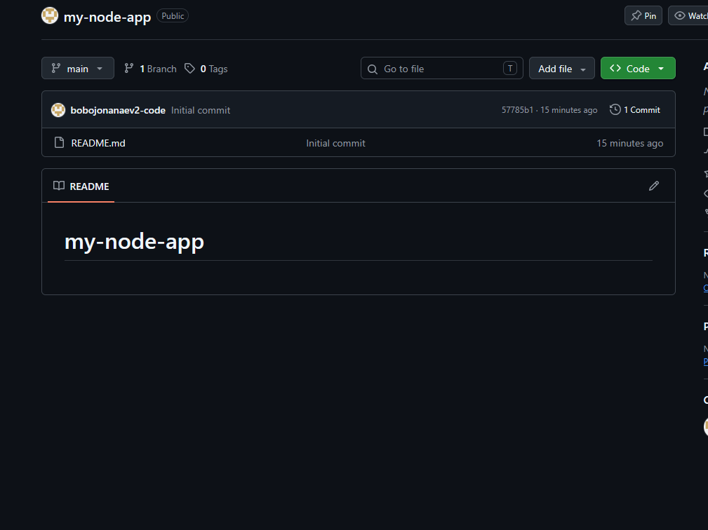
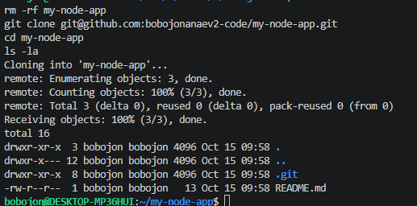
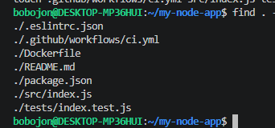
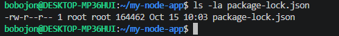
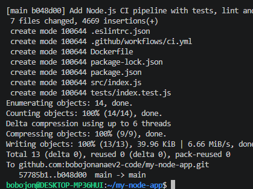
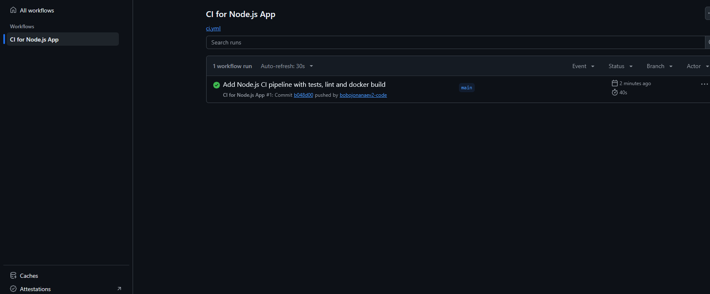
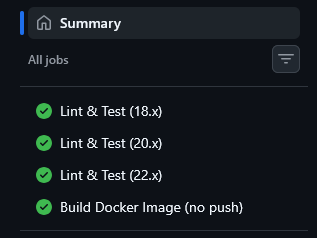
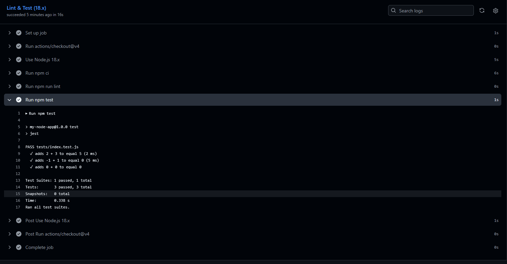
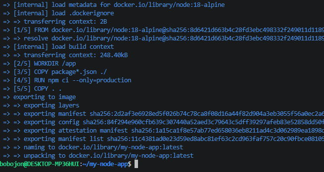
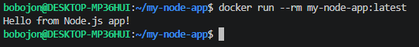

# 03. Pipeline CI на Node.js в GitHub Actions

CI-пайплайн для Node.js-приложения: линтинг (ESLint), тесты (Jest), сборка Docker-образа без публикации.

## Задание

Источник: [content/DevOps/CI_CD/Pipelines/NodeJS.md](https://gitflic.ru/project/rurewa/mfua/blob?file=content/DevOps/CI_CD/Pipelines/NodeJS.md&branch=master)
Отдельный репозиторий: [bobojonanaev2-code/my-node-app](https://github.com/bobojonanaev2-code/my-node-app)

## Что сделано

- Создан публичный репозиторий `my-node-app`
- Workflow `.github/workflows/ci.yml` с двумя jobs:
  - **test** — матрица Node.js 18/20/22: `npm ci`, ESLint, Jest
  - **docker-build** — сборка Docker-образа (без публикации), только при push в main
- `package-lock.json` сгенерирован через Docker (`node:18-alpine`)
- Проверено: зелёные галочки во всех jobs
- Локально собран и запущен Docker-образ

## Структура проекта

```
my-node-app/
├── .github/workflows/ci.yml
├── src/index.js
├── tests/index.test.js
├── package.json
├── package-lock.json
├── .eslintrc.json
├── Dockerfile
└── README.md
```

## Код приложения

```javascript
// src/index.js
function add(a, b) {
    return a + b;
}

function main() {
    console.log("Hello from Node.js app!");
}

if (require.main === module) {
    main();
}

module.exports = { add };
```

## Тесты

```javascript
// tests/index.test.js
const { add } = require('../src/index');

test('adds 2 + 3 to equal 5', () => {
    expect(add(2, 3)).toBe(5);
});

test('adds -1 + 1 to equal 0', () => {
    expect(add(-1, 1)).toBe(0);
});

test('adds 0 + 0 to equal 0', () => {
    expect(add(0, 0)).toBe(0);
});
```

## Локальная сборка

```bash
docker build -t my-node-app:latest .
docker run --rm my-node-app:latest
# → Hello from Node.js app!
```

## Результат

- Actions: https://github.com/bobojonanaev2-code/my-node-app/actions
- Все jobs — ✅

## Скриншоты

### 1. Создание репозитория


### 2. Клонирование


### 3. Структура проекта


### 4. Генерация package-lock.json


### 5. Push


### 6. Список workflow в Actions


### 7. Jobs (матрица Node.js + Docker)


### 8. Вывод Jest


### 9. Локальная сборка Docker-образа


### 10. Запуск контейнера
