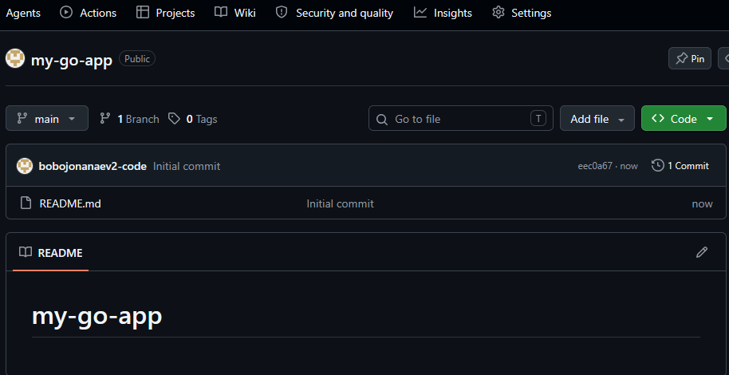
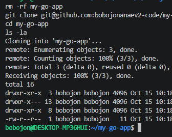
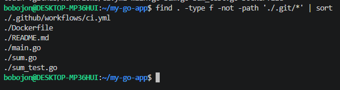
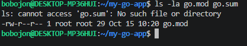
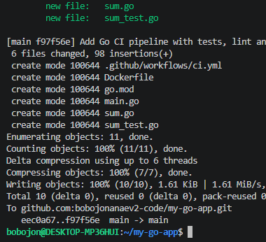
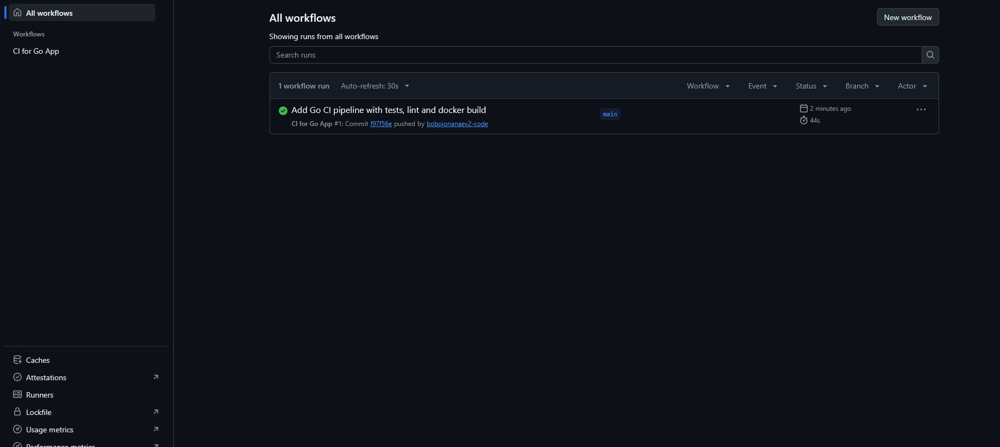
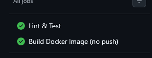
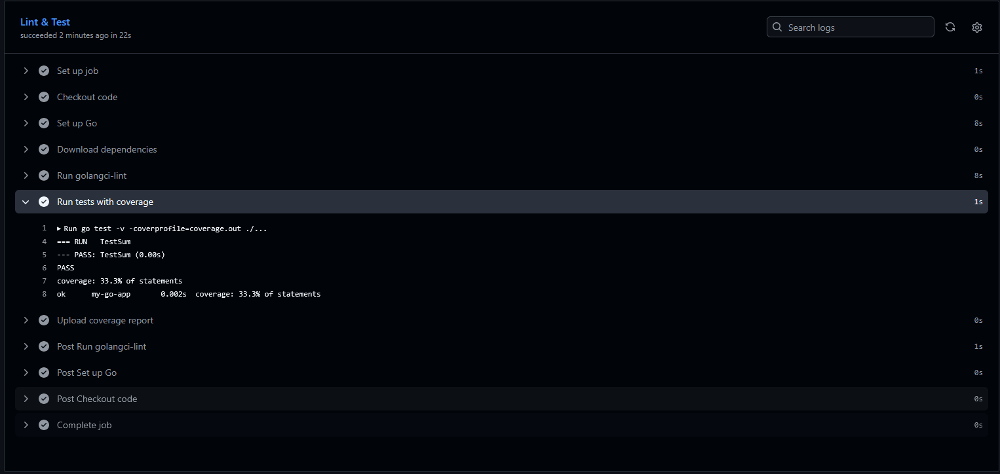
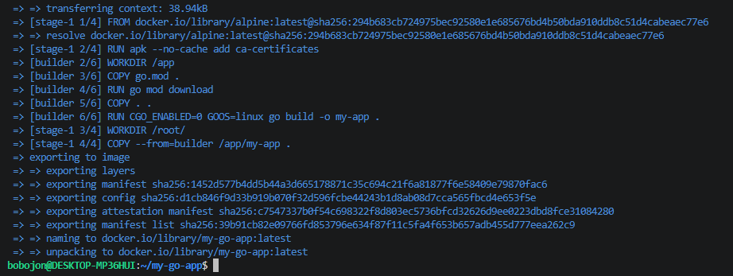
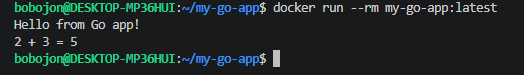

# 04. Pipeline CI на Go в GitHub Actions

CI-пайплайн для Go-приложения: линтер (golangci-lint), тесты с покрытием, сборка Docker-образа.

## Задание

Источник: [content/DevOps/CI_CD/Pipelines/Go.md](https://gitflic.ru/project/rurewa/mfua/blob?file=content/DevOps/CI_CD/Pipelines/Go.md&branch=master)
Отдельный репозиторий: [bobojonanaev2-code/my-go-app](https://github.com/bobojonanaev2-code/my-go-app)

## Что сделано

- Создан публичный репозиторий `my-go-app`
- Workflow `.github/workflows/ci.yml` с двумя jobs:
  - **test** — `go mod download`, golangci-lint, `go test` с coverage, upload coverage как artifact
  - **docker-build** — сборка Docker-образа (без публикации), только при push в main
- `go.mod` сгенерирован через Docker (`golang:1.22-alpine`)
- Проверено: зелёные галочки во всех jobs
- Локально собран и запущен Docker-образ

## Структура проекта

```
my-go-app/
├── .github/workflows/ci.yml
├── main.go
├── sum.go
├── sum_test.go
├── go.mod
├── Dockerfile
└── README.md
```

## Код приложения

```go
// sum.go
package main

func Sum(a, b int) int {
    return a + b
}
```

## Тесты

```go
// sum_test.go
package main

import "testing"

func TestSum(t *testing.T) {
    tests := []struct {
        a, b, expected int
    }{
        {2, 3, 5},
        {-1, 1, 0},
        {0, 0, 0},
    }
    for _, tt := range tests {
        result := Sum(tt.a, tt.b)
        if result != tt.expected {
            t.Errorf("Sum(%d, %d) = %d; want %d", tt.a, tt.b, result, tt.expected)
        }
    }
}
```

## Локальная сборка

```bash
docker build -t my-go-app:latest .
docker run --rm my-go-app:latest
# → Hello from Go app!
#   2 + 3 = 5
```

## Результат

- Actions: https://github.com/bobojonanaev2-code/my-go-app/actions
- Все jobs — ✅

## Скриншоты

### 1. Создание репозитория


### 2. Клонирование


### 3. Структура проекта


### 4. Инициализация go.mod


### 5. Push


### 6. Список workflow в Actions


### 7. Jobs


### 8. Вывод go test


### 9. Локальная сборка Docker-образа


### 10. Запуск контейнера
