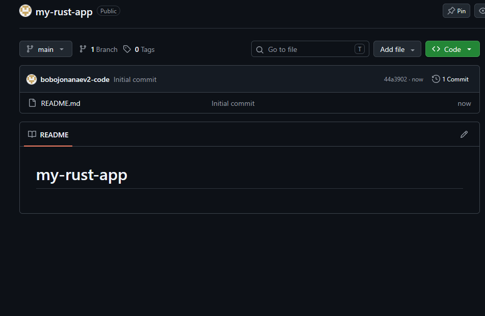
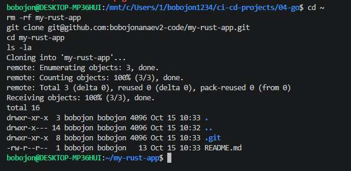
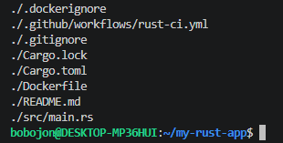
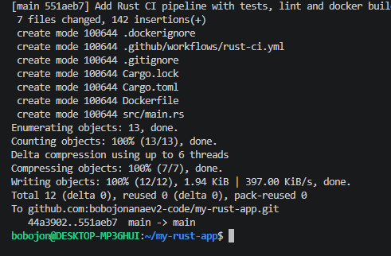
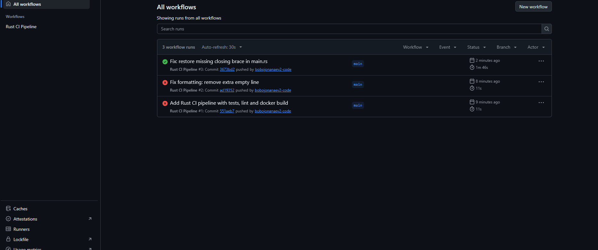
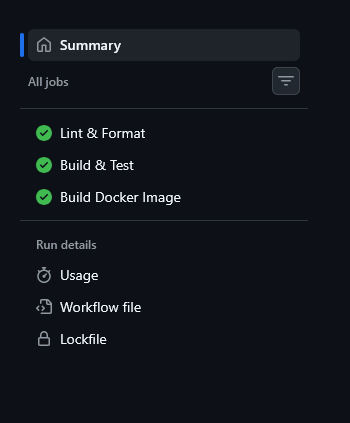
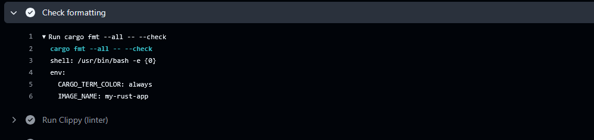
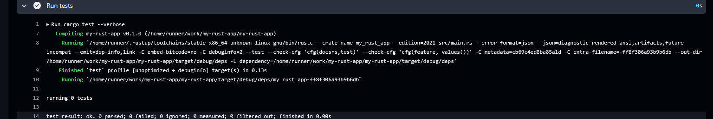
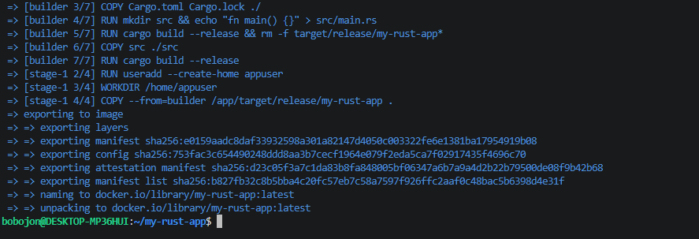

# 05. Pipeline CI на Rust в GitHub Actions

CI-пайплайн для Rust-приложения: форматирование (rustfmt), линтер (clippy), тесты, сборка Docker-образа.

## Задание

Источник: [content/DevOps/CI_CD/Pipelines/Rust_CI_1.md](https://gitflic.ru/project/rurewa/mfua/blob?file=content/DevOps/CI_CD/Pipelines/Rust_CI_1.md&branch=master)
Отдельный репозиторий: [bobojonanaev2-code/my-rust-app](https://github.com/bobojonanaev2-code/my-rust-app)

## Что сделано

- Создан публичный репозиторий `my-rust-app`
- Workflow `.github/workflows/rust-ci.yml` с тремя jobs:
  - **lint** — `cargo fmt --check`, `cargo clippy -- -D warnings`
  - **test** — `cargo check`, `cargo build` (debug + release), `cargo test`
  - **docker-build** — сборка Docker-образа через Buildx, сохранение как artifact, запуск для проверки
- Dockerfile — multi-stage (builder `rust:1-slim` → `debian:stable-slim`)
- Проверено: зелёные галочки во всех jobs
- Локально собран и запущен Docker-образ

## Структура проекта

```
my-rust-app/
├── .github/workflows/rust-ci.yml
├── src/main.rs
├── Cargo.toml
├── Cargo.lock
├── Dockerfile
├── .dockerignore
├── .gitignore
└── README.md
```

## Код приложения

```rust
// src/main.rs
use std::io::{self, Write};

fn main() {
    println!("Hello from Rust in Docker! 🦀");
    io::stdout().flush().unwrap();
    std::thread::sleep(std::time::Duration::from_millis(200));
}
```

## Локальная сборка

```bash
docker build -t my-rust-app:latest .
docker run --rm my-rust-app:latest
# → Hello from Rust in Docker! 🦀
```

## Результат

- Actions: https://github.com/bobojonanaev2-code/my-rust-app/actions
- Все jobs — ✅

## Скриншоты

### 1. Создание репозитория


### 2. Клонирование


### 3. Структура проекта


### 4. Push


### 5. Список workflow в Actions


### 6. Jobs (lint, test, docker-build)


### 7. Вывод линтера (rustfmt + clippy)


### 8. Вывод cargo test


### 9. Локальная сборка Docker-образа


### 10. Запуск контейнера
