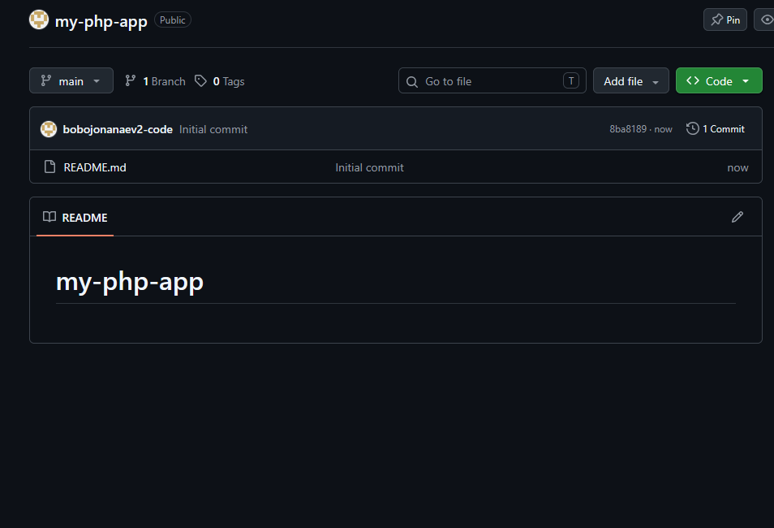
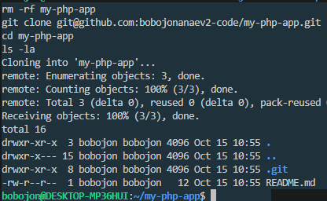
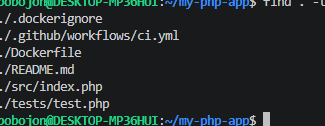
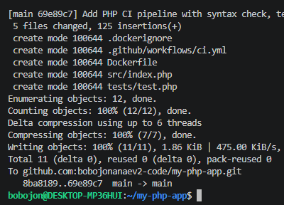
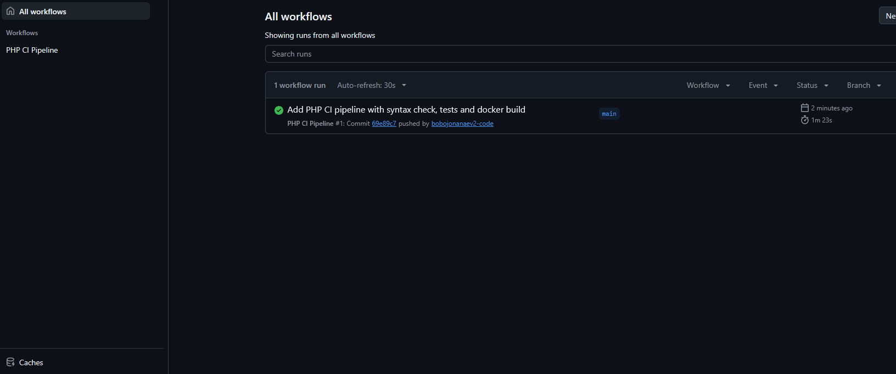
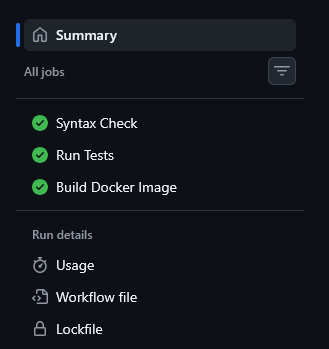
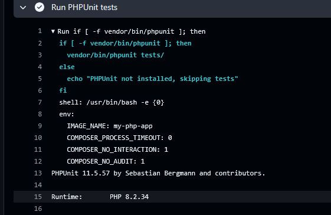
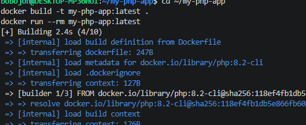
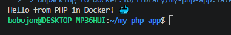

# 06. Pipeline CI на PHP в GitHub Actions

CI-пайплайн для PHP-приложения: проверка синтаксиса, тесты PHPUnit, сборка Docker-образа.

## Задание

Источник: [content/DevOps/CI_CD/Pipelines/PHP.md](https://gitflic.ru/project/rurewa/mfua/blob?file=content/DevOps/CI_CD/Pipelines/PHP.md&branch=master)
Отдельный репозиторий: [bobojonanaev2-code/my-php-app](https://github.com/bobojonanaev2-code/my-php-app)

## Что сделано

- Создан публичный репозиторий `my-php-app`
- Workflow `.github/workflows/ci.yml` с тремя jobs:
  - **lint** — проверка синтаксиса PHP (`php -l`)
  - **test** — установка PHPUnit через Composer, прогон тестов
  - **docker-build** — сборка Docker-образа через Buildx, запуск для проверки
- Dockerfile — multi-stage (builder `php:8.2-cli` → финал `php:8.2-cli` + appuser)
- Проверено: зелёные галочки во всех jobs
- Локально собран и запущен Docker-образ

## Структура проекта

```
my-php-app/
├── .github/workflows/ci.yml
├── src/index.php
├── tests/test.php
├── Dockerfile
├── .dockerignore
└── README.md
```

## Код приложения

```php
// src/index.php
<?php

function getGreeting() {
    return "Hello from PHP in Docker! 🐳";
}

echo getGreeting() . PHP_EOL;
```

## Тесты

```php
// tests/test.php
<?php
use PHPUnit\Framework\TestCase;

class GreetingTest extends TestCase
{
    public function testGetGreeting()
    {
        require_once __DIR__ . '/../src/index.php';

        $greeting = getGreeting();
        $this->assertEquals("Hello from PHP in Docker! 🐳", $greeting);
        $this->assertStringContainsString("PHP", $greeting);
        $this->assertStringContainsString("Docker", $greeting);
    }
}
```

## Локальная сборка

```bash
docker build -t my-php-app:latest .
docker run --rm my-php-app:latest
# → Hello from PHP in Docker! 🐳
```

## Результат

- Actions: https://github.com/bobojonanaev2-code/my-php-app/actions
- Все jobs — ✅

## Скриншоты

### 1. Создание репозитория


### 2. Клонирование


### 3. Структура проекта


### 4. Push


### 5. Список workflow в Actions


### 6. Jobs


### 7. Вывод PHPUnit


### 8. Локальная сборка Docker-образа


### 9. Запуск контейнера
