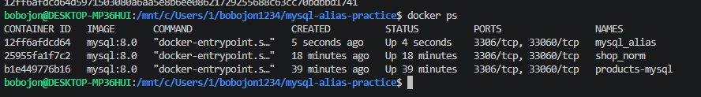
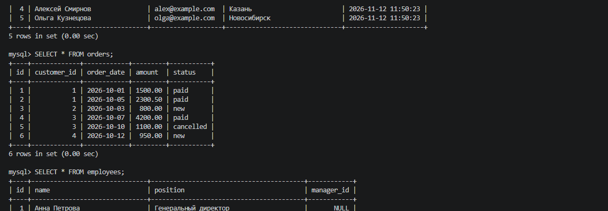
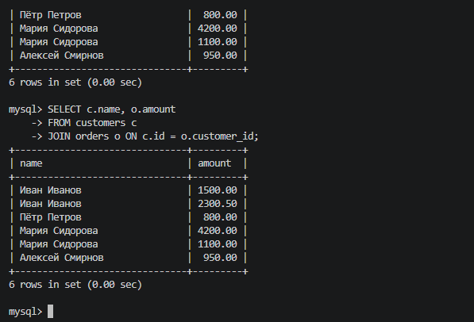
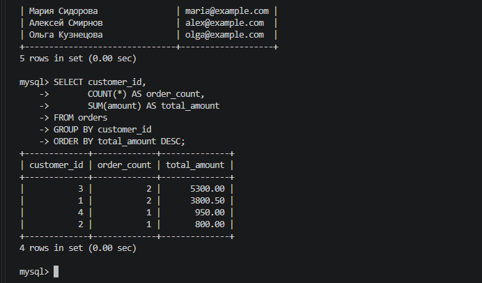
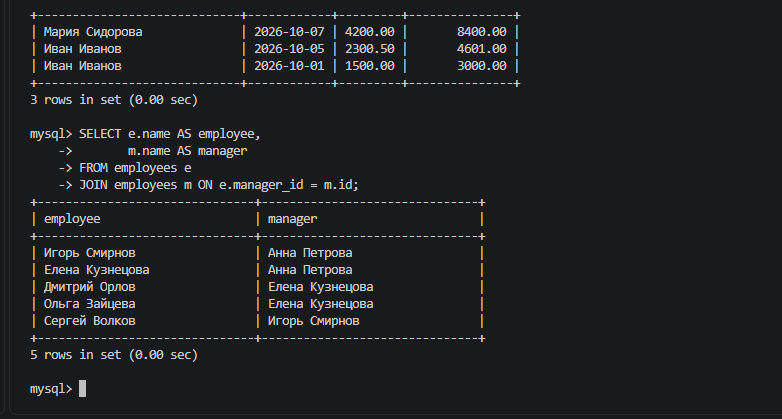
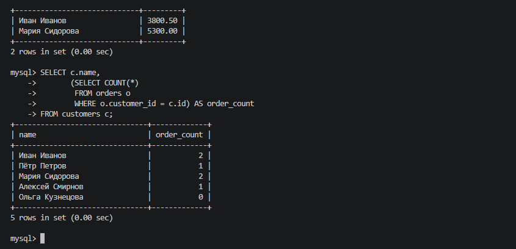
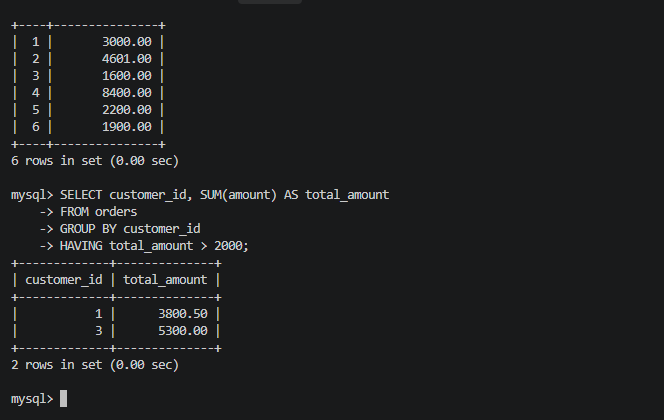
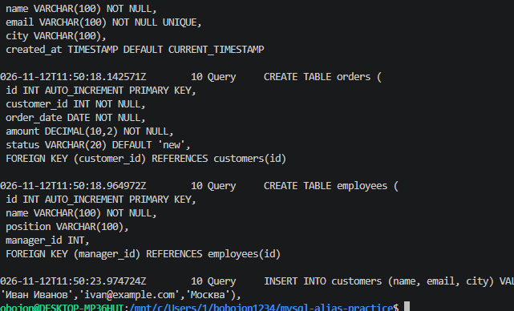
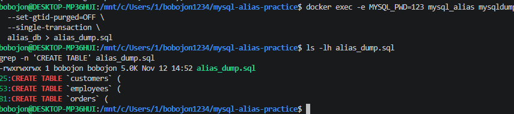

# Практическая работа № 6 — Алиасы в MySQL

**Дисциплина:** Основы проектирования баз данных  
**Задание:** [Aliases.md — учебное руководство по алиасам в SQL](https://github.com/rurewa/imfua/blob/main/content/Courses/Basics_database_design/content/bd/Aliases.md)  
**Инструменты:** MySQL 8.0, Docker Desktop, WSL Ubuntu, VS Code, Git.

## Цель работы

Научиться использовать **алиасы (псевдонимы) таблиц и столбцов** в SQL-запросах, соединениях `JOIN`, агрегатных функциях и подзапросах. Проверить типичную ошибку с алиасом в `WHERE`, сохранить дамп базы и журнал SQL-команд.

## Структура проекта

```text
mysql-alias-practice/
├── README.md
├── my.cnf
├── alias_dump.sql
├── general.log
├── my_actions.log
└── screenshots/
    ├── 01-container.png
    ├── 02-data.png
    ├── 03-table-aliases.png
    ├── 04-column-aliases.png
    ├── 05-joins.png
    ├── 06-subqueries.png
    ├── 07-alias-errors.png
    ├── 08-log.png
    └── 09-dump.png
```

## 1. Запуск MySQL в Docker

Подготовлен файл [`my.cnf`](my.cnf) с кодировкой `utf8mb4` и записью SQL-запросов в `/var/lib/mysql/general.log`:

```ini
[mysqld]
character-set-server = utf8mb4
collation-server = utf8mb4_unicode_ci
general_log = 1
general_log_file = /var/lib/mysql/general.log
log_output = FILE

[client]
default-character-set = utf8mb4

[mysql]
default-character-set = utf8mb4
```

Для практической работы использован отдельный контейнер `mysql_alias` с томом `mysql_alias_data`:

```bash
docker run --name mysql_alias \
  -e MYSQL_ROOT_PASSWORD=123 \
  -e LANG=C.UTF-8 \
  -e MYSQL_INITDB_SKIP_TZINFO=1 \
  -v mysql_alias_data:/var/lib/mysql \
  -v "$HOME/mysql-alias-config/my.cnf:/etc/mysql/conf.d/my.cnf:ro" \
  -d mysql:8.0

docker ps
```

После инициализации MySQL общий лог был очищен, чтобы не сохранять большое количество служебных записей.



## 2. Создание базы данных и таблиц

Создана база `alias_db` с тремя таблицами:

| Таблица | Назначение |
|---|---|
| `customers` | Клиенты, электронная почта, город |
| `orders` | Заказы клиентов, суммы, даты и статусы |
| `employees` | Сотрудники и их руководители |

```sql
CREATE DATABASE alias_db
  CHARACTER SET utf8mb4 COLLATE utf8mb4_unicode_ci;
USE alias_db;

CREATE TABLE customers (
    id INT AUTO_INCREMENT PRIMARY KEY,
    name VARCHAR(100) NOT NULL,
    email VARCHAR(100) NOT NULL UNIQUE,
    city VARCHAR(100),
    created_at TIMESTAMP DEFAULT CURRENT_TIMESTAMP
);

CREATE TABLE orders (
    id INT AUTO_INCREMENT PRIMARY KEY,
    customer_id INT NOT NULL,
    order_date DATE NOT NULL,
    amount DECIMAL(10,2) NOT NULL,
    status VARCHAR(20) DEFAULT 'new',
    FOREIGN KEY (customer_id) REFERENCES customers(id)
);

CREATE TABLE employees (
    id INT AUTO_INCREMENT PRIMARY KEY,
    name VARCHAR(100) NOT NULL,
    position VARCHAR(100),
    manager_id INT,
    FOREIGN KEY (manager_id) REFERENCES employees(id)
);
```

В таблицы добавлены учебные данные: **5 клиентов, 6 заказов и 6 сотрудников**. Проверка выполнена командами:

```sql
SELECT * FROM customers;
SELECT * FROM orders;
SELECT * FROM employees;
```



## 3. Алиасы таблиц

Сравнение обычного запроса с использованием коротких имён `c` и `o`:

```sql
-- Без алиасов
SELECT customers.name, orders.amount
FROM customers
JOIN orders ON customers.id = orders.customer_id;

-- С алиасами
SELECT c.name, o.amount
FROM customers c
JOIN orders o ON c.id = o.customer_id;
```

Во втором запросе результат тот же, но запись короче и понятнее. Алиас таблицы действует в пределах одного SQL-запроса.



## 4. Алиасы столбцов и агрегатные функции

Оператор `AS` позволяет назначить удобное имя столбцу или результату вычисления:

```sql
SELECT name AS customer_name,
       email AS contact_email
FROM customers;

SELECT customer_id,
       COUNT(*) AS order_count,
       SUM(amount) AS total_amount
FROM orders
GROUP BY customer_id
ORDER BY total_amount DESC;
```

Имена `customer_name`, `order_count` и `total_amount` делают результат более понятным. Алиас `total_amount` также используется в сортировке.



## 5. Алиасы в JOIN и самосоединении

Выборка оплаченных заказов с вычисляемой суммой:

```sql
SELECT c.name AS customer,
       o.order_date,
       o.amount,
       o.amount * 2 AS double_amount
FROM customers c
JOIN orders o ON c.id = o.customer_id
WHERE o.status = 'paid'
ORDER BY double_amount DESC;
```

Самосоединение `employees` позволяет получить сотрудника и его руководителя из **одной таблицы**:

```sql
SELECT e.name AS employee,
       m.name AS manager
FROM employees e
JOIN employees m ON e.manager_id = m.id;
```

Здесь `e` обозначает сотрудника, а `m` — его руководителя.



## 6. Алиасы в подзапросах

В первом примере подзапрос выступает как производная таблица `o`, во втором вычисляется число заказов каждого клиента:

```sql
SELECT c.name, o.total
FROM customers c
JOIN (
    SELECT customer_id, SUM(amount) AS total
    FROM orders
    GROUP BY customer_id
) o ON c.id = o.customer_id
WHERE o.total > 2000;

SELECT c.name,
       (SELECT COUNT(*)
        FROM orders o
        WHERE o.customer_id = c.id) AS order_count
FROM customers c;
```

Алиасы помогают различать таблицы и обращаться к результатам подзапросов.



## 7. Распространённая ошибка: алиас в WHERE

Попытка обратиться в `WHERE` к алиасу, объявленному в `SELECT`, вызывает ошибку:

```sql
-- Ошибка: Unknown column 'double_amount' in 'where clause'
SELECT id, amount * 2 AS double_amount
FROM orders
WHERE double_amount > 1000;
```

Правильно повторить выражение в условии:

```sql
SELECT id, amount * 2 AS double_amount
FROM orders
WHERE amount * 2 > 1000;
```

Для фильтрации групп по агрегатному результату можно использовать `HAVING`:

```sql
SELECT customer_id, SUM(amount) AS total_amount
FROM orders
GROUP BY customer_id
HAVING total_amount > 2000;
```

**Вывод:** алиасы столбцов доступны в `ORDER BY`, но не в `WHERE`; MySQL также поддерживает их в `HAVING`.



## 8. Логирование SQL-запросов

В течение работы запросы записывались в общий журнал MySQL. После выполнения упражнений логирование было отключено, а журнал скопирован в проект:

```bash
docker exec -e MYSQL_PWD=123 mysql_alias mysql -uroot \
  -e "SET GLOBAL general_log='OFF';"

docker cp mysql_alias:/var/lib/mysql/general.log ./general.log
```

Из общего журнала также подготовлен файл [`my_actions.log`](my_actions.log) с учебными SQL-запросами. Общий журнал доступен в [`general.log`](general.log).



## 9. Создание резервной копии базы

С помощью `mysqldump` создан SQL-дамп базы `alias_db`:

```bash
docker exec -e MYSQL_PWD=123 mysql_alias mysqldump -uroot \
  --set-gtid-purged=OFF \
  --single-transaction \
  alias_db > alias_dump.sql
```

Файл [`alias_dump.sql`](alias_dump.sql) содержит структуру и данные таблиц `customers`, `orders` и `employees`.



## Вывод

В практической работе изучены **алиасы таблиц и столбцов**, их применение в `JOIN`, самосоединениях, вычислениях, сортировке и подзапросах. Показано, почему алиас из `SELECT` нельзя использовать в `WHERE`. База данных сохранена в SQL-дампе, а выполненные команды — в журналах.
