# Практическая работа № 1 — Интерактивная работа с MySQL в Docker

**Тема:** Интерактивная работа с MySQL в изолированном окружении Docker. Движок хранения данных InnoDB.

**Исходное задание:** [«Интерактивная работа с MySQL в изолированном окружении Docker № 1»](https://gitflic.ru/project/rurewa/mfua/blob?file=content/Database/mysql_docker_1.md&branch=master)

## Цель работы

Научиться запускать MySQL в Docker-контейнере, подключаться к СУБД через терминал, создавать базы данных и таблицы, выполнять основные SQL-операции, вести журнал запросов и создавать резервную копию базы данных.

## Что выполнено

- Подготовлено Docker-окружение и создан каталог проекта `mysql-docker-practice`.
- Настроен MySQL через файл `my.cnf`: кодировка `utf8mb4` и журнал SQL-запросов.
- Запущен контейнер `my-mysql` на основе образа `mysql:8.0` с томом `mysql_data`.
- Выполнены SQL-запросы `SHOW`, `CREATE`, `INSERT`, `SELECT`, `UPDATE`, `DELETE` и `DROP`.
- Создана тестовая база данных `sql_practice` и её дамп `dump.sql`.
- Сохранены журнал SQL-запросов `general.log` и логи контейнера `log.txt`.
- Проверены остановка и повторный запуск контейнера.

## Структура проекта

```text
mysql-docker-practice/
├── README.md
├── my.cnf
├── dump.sql
├── general.log
├── log.txt
└── screenshots/
    ├── 01-cleanup.png
    ├── 02-run.png
    ├── 03-ps.png
    ├── 04-show-databases.png
    ├── 05-create-table.png
    ├── 06-update.png
    ├── 07-delete.png
    ├── 08-drop.png
    ├── 09-dump.png
    ├── 10-dump-content.png
    ├── 11-log.png
    └── 12-manage.png
```

## Ход выполнения работы

### 1. Подготовка Docker-окружения

Просмотрены существующие контейнеры, остановлены запущенные и удалены ненужные ресурсы Docker.

```bash
docker ps -a
docker stop $(docker ps -q)
docker container prune -f
docker volume prune -f
```

> **Примечание:** команды очистки могут затронуть контейнеры и тома других проектов. В рамках практической работы они использовались для подготовки окружения.

**Скриншот 1 — подготовка и очистка Docker:**

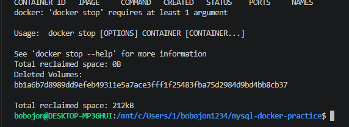

### 2. Настройка и запуск MySQL

В каталоге проекта создан файл `my.cnf` с настройками кодировки и ведения журнала запросов:

```ini
[mysqld]
character-set-server = utf8mb4
collation-server = utf8mb4_unicode_ci
general_log = 1
general_log_file = /var/lib/mysql/general.log
log_output = FILE

[client]
default-character-set = utf8mb4

[mysql]
default-character-set = utf8mb4
```

Запущен контейнер MySQL 8.0 с сохранением данных в именованном томе `mysql_data`:

```bash
docker run --name my-mysql \
  -e MYSQL_ROOT_PASSWORD=123 \
  -e LANG=C.UTF-8 \
  -v mysql_data:/var/lib/mysql \
  -v $(pwd)/my.cnf:/etc/mysql/conf.d/my.cnf \
  -d mysql:8.0
```

Пароль `123` использован только для учебного окружения.

**Скриншот 2 — запуск MySQL-контейнера:**

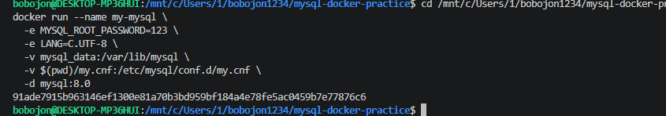

### 3. Проверка работы контейнера

Командой `docker ps` проверено, что контейнер `my-mysql` запущен.

```bash
docker ps
```

**Скриншот 3 — состояние контейнера:**

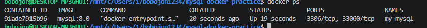

### 4. Подключение к MySQL и просмотр баз данных

Открыт интерактивный клиент MySQL под пользователем `root`:

```bash
docker exec -it my-mysql mysql --default-character-set=utf8mb4 -uroot -p
```

После ввода пароля выполнена команда просмотра существующих баз данных:

```sql
SHOW DATABASES;
```

**Скриншот 4 — список баз данных:**

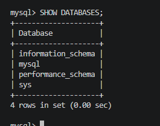

### 5. Создание базы данных, таблицы и добавление записей

Создана база `my_database` с кодировкой `utf8mb4`, затем таблица `users` с полями `id`, `name`, `email`. Добавлены три тестовые записи и выполнен запрос их просмотра.

```sql
CREATE DATABASE my_database
  CHARACTER SET utf8mb4
  COLLATE utf8mb4_unicode_ci;

USE my_database;

CREATE TABLE users (
    id INT AUTO_INCREMENT PRIMARY KEY,
    name VARCHAR(100) NOT NULL,
    email VARCHAR(100) NOT NULL UNIQUE
) CHARACTER SET utf8mb4 COLLATE utf8mb4_unicode_ci;

INSERT INTO users (name, email) VALUES
  ('Иван Иванов', 'ivan@example.com'),
  ('Пётр Петров', 'petr@example.com'),
  ('Мария Сидорова', 'maria@example.com');

SELECT * FROM users;
```

В MySQL 8.0 для такой таблицы по умолчанию используется InnoDB.

**Скриншот 5 — создание таблицы и вставка данных:**

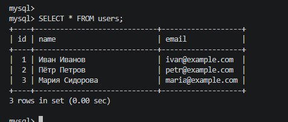

### 6. Добавление и изменение данных

В таблицу добавлен ещё один пользователь, после чего изменено имя записи с `id = 1`. Результат проверен запросом `SELECT`.

```sql
INSERT INTO users (name, email)
VALUES ('Павел Иванов', 'pavel@example.com');

UPDATE users SET name = 'Иван Петров' WHERE id = 1;

SELECT * FROM users;
```

**Скриншот 6 — выполнение UPDATE:**

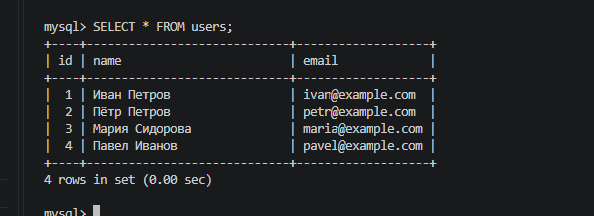

### 7. Удаление записи

Удалена запись с `id = 2`, после чего содержимое таблицы выведено повторно.

```sql
DELETE FROM users WHERE id = 2;
SELECT * FROM users;
```

Условие `WHERE` ограничивает удаление конкретной строкой.

**Скриншот 7 — выполнение DELETE:**

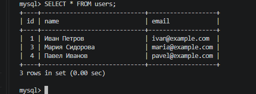

### 8. Удаление таблицы и базы данных

После выполнения основных операций таблица `users` и учебная база `my_database` удалены. Повторно проверен список баз данных.

```sql
DROP TABLE users;
DROP DATABASE my_database;
SHOW DATABASES;
```

**Скриншот 8 — удаление таблицы и базы данных:**

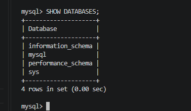

### 9. Создание тестовой базы и SQL-дампа

Для демонстрации резервного копирования создана отдельная база `sql_practice` с таблицей `test` и одной записью:

```bash
docker exec -i my-mysql mysql -uroot -p123 -e "CREATE DATABASE IF NOT EXISTS sql_practice; USE sql_practice; CREATE TABLE test (id INT, name VARCHAR(50)); INSERT INTO test VALUES (1, 'hello');"
```

Затем база экспортирована в файл `dump.sql`:

```bash
docker exec my-mysql mysqldump -uroot -p123 --set-gtid-purged=OFF sql_practice > dump.sql
```

**Скриншот 9 — создание дампа:**

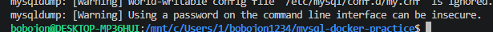

### 10. Просмотр содержимого дампа

Проверено, что файл `dump.sql` содержит SQL-инструкции для восстановления структуры и данных базы.

```bash
cat dump.sql | head -20
```

**Скриншот 10 — содержимое SQL-дампа:**

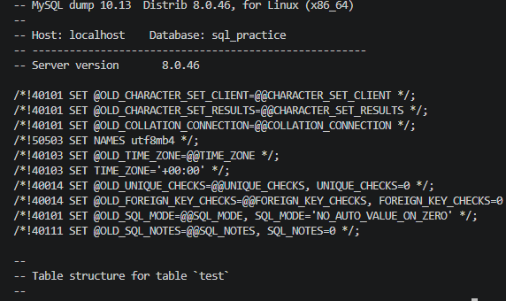

### 11. Получение журнала SQL-запросов

Благодаря настройке `general_log = 1` MySQL записывает события в файл `/var/lib/mysql/general.log`. Журнал скопирован на хост:

```bash
docker cp my-mysql:/var/lib/mysql/general.log ./general.log
```

**Скриншот 11 — копирование журнала:**

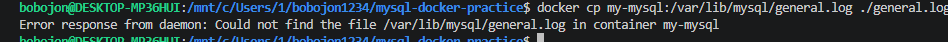

### 12. Управление контейнером и сохранение логов

Проверены команды остановки и повторного запуска MySQL-контейнера. Вывод `docker logs` сохранён в отдельный файл.

```bash
docker stop my-mysql
docker start my-mysql
docker logs my-mysql > log.txt
```

**Скриншот 12 — управление контейнером:**

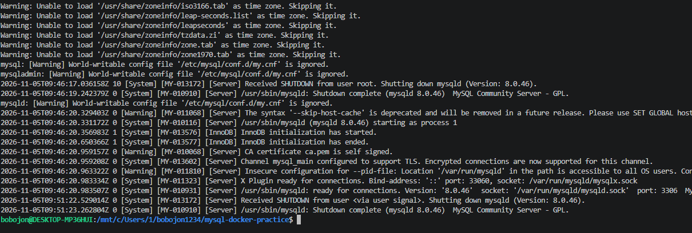

## Результат

В рамках практической работы были использованы Docker, MySQL 8.0 и движок InnoDB. Отработаны подключение к СУБД, создание и удаление баз данных и таблиц, выборка и изменение записей, создание SQL-дампа, работа с журналами и управление контейнером.

Основные артефакты работы:

| Файл | Назначение |
| --- | --- |
| `my.cnf` | Конфигурация MySQL, кодировка и логирование |
| `dump.sql` | Резервная копия учебной базы `sql_practice` |
| `general.log` | Журнал событий и запросов MySQL |
| `log.txt` | Логи Docker-контейнера |
| `screenshots/` | 12 скриншотов выполнения работы |

## Вывод

Выполненная работа позволила закрепить базовые навыки использования СУБД MySQL в Docker: от настройки и запуска контейнера до выполнения SQL-операций, создания резервной копии и сохранения логов. Использование тома Docker обеспечивает хранение файлов базы данных отдельно от жизненного цикла контейнера.

<!-- work -->
