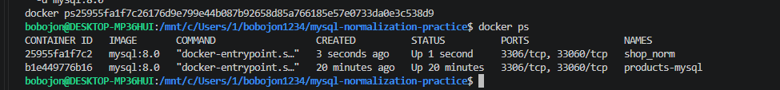
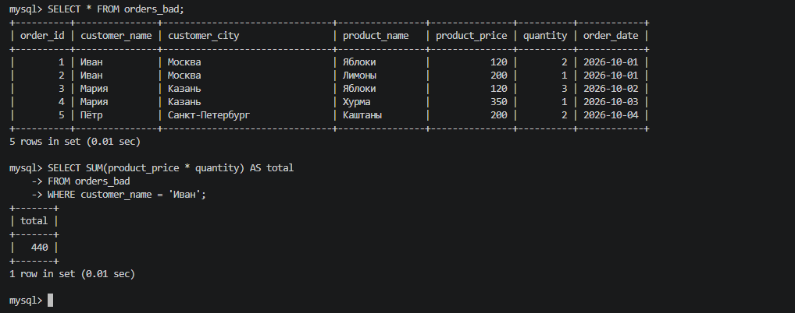
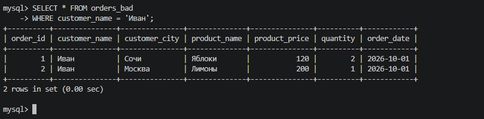
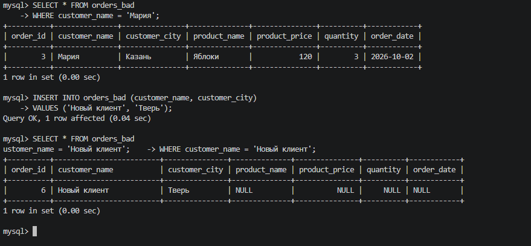
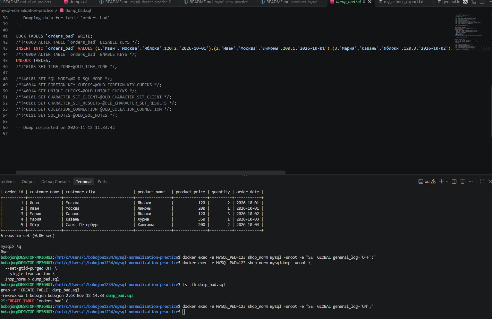
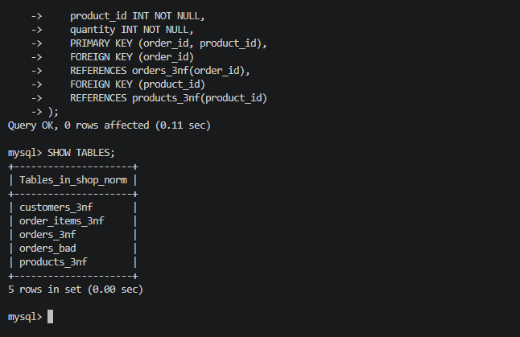
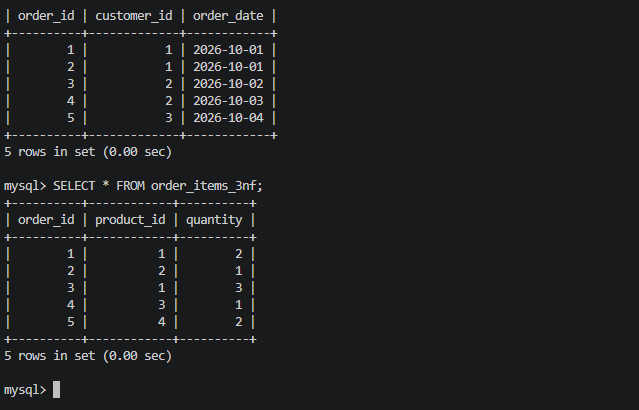
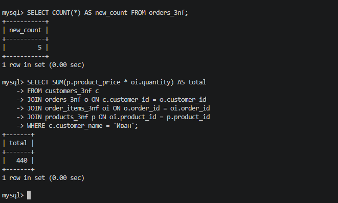
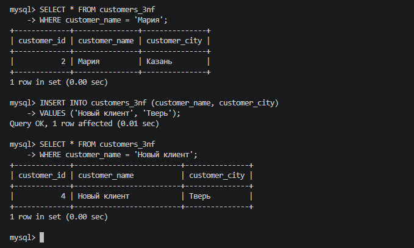

# Практическая работа № 5 — Нормализация данных в MySQL (3NF)

**Дисциплина:** Основы проектирования баз данных  
**Задание:** `Normalization.md` — «Нормализация данных. Практическое руководство (с ведением лога)»  
**Инструменты:** MySQL 8.0, Docker Desktop, WSL Ubuntu, VS Code, Git.

## Цель работы

Создать ненормализованную таблицу заказов, показать **аномалии обновления, удаления и вставки**, преобразовать её в схему **третьей нормальной формы (3NF)** и убедиться, что данные перенеслись правильно. Сохранить дампы базы **до и после нормализации** и журнал выполненных SQL-запросов.

## Состав проекта

```text
mysql-normalization-practice/
├── README.md
├── my.cnf
├── dump_bad.sql       # База до нормализации
├── norm_dump.sql      # База после нормализации
├── general.log        # Общий SQL-журнал
├── my_actions.log     # Выборка учебных SQL-команд
└── screenshots/
    ├── 01-container.png
    ├── 02-bad-table.png
    ├── 03-update-anomaly.png
    ├── 04-anomalies.png
    ├── 05-bad-dump.png
    ├── 06-3nf-tables.png
    ├── 07-transfer.png
    ├── 08-verification.png
    └── 09-final-result.png
```

## 1. Запуск MySQL в Docker

Подготовлена конфигурация `my.cnf`, включающая кодировку `utf8mb4` и файловое логирование:

```ini
[mysqld]
character-set-server = utf8mb4
collation-server = utf8mb4_unicode_ci
general_log = 1
general_log_file = /var/lib/mysql/general.log
log_output = FILE

[client]
default-character-set = utf8mb4

[mysql]
default-character-set = utf8mb4
```

Запущен отдельный контейнер **`shop_norm`** на базе образа `mysql:8.0` с томом `shop_norm_data`. После завершения инициализации сервера журнал был очищен, чтобы в нём преобладали учебные запросы.

```bash
docker ps
docker exec -it shop_norm mysql --default-character-set=utf8mb4 -uroot -p
```



## 2. Создание исходной таблицы `orders_bad`

Создана база `shop_norm`. В исходной таблице сведения о клиенте и товаре повторяются в каждой строке заказа:

```sql
CREATE DATABASE shop_norm
  CHARACTER SET utf8mb4 COLLATE utf8mb4_unicode_ci;
USE shop_norm;

CREATE TABLE orders_bad (
    order_id INT AUTO_INCREMENT PRIMARY KEY,
    customer_name VARCHAR(100),
    customer_city VARCHAR(100),
    product_name VARCHAR(100),
    product_price INT,
    quantity INT,
    order_date DATE
);

INSERT INTO orders_bad
(customer_name, customer_city, product_name, product_price, quantity, order_date)
VALUES
('Иван', 'Москва', 'Яблоки', 120, 2, '2026-10-01'),
('Иван', 'Москва', 'Лимоны', 200, 1, '2026-10-01'),
('Мария', 'Казань', 'Яблоки', 120, 3, '2026-10-02'),
('Мария', 'Казань', 'Хурма', 350, 1, '2026-10-03'),
('Пётр', 'Санкт-Петербург', 'Каштаны', 200, 2, '2026-10-04');

SELECT * FROM orders_bad;
```

В таблице **5 строк**, но имена, города и цены товаров дублируются.



## 3. Демонстрация аномалий

### Аномалия обновления

```sql
UPDATE orders_bad SET customer_city = 'Сочи' WHERE order_id = 1;
SELECT * FROM orders_bad WHERE customer_name = 'Иван';
```

У Ивана появляются два разных города — **Сочи и Москва**, хотя речь об одном клиенте.



### Аномалия удаления

```sql
DELETE FROM orders_bad WHERE order_id = 4;
SELECT * FROM orders_bad WHERE customer_name = 'Мария';
```

После удаления одной строки Мария ещё присутствует в базе. Но если удалить **все** её заказы, запись о клиенте исчезнет: данные клиента нельзя хранить независимо от заказов.

### Аномалия вставки

```sql
INSERT INTO orders_bad (customer_name, customer_city)
VALUES ('Новый клиент', 'Тверь');
SELECT * FROM orders_bad WHERE customer_name = 'Новый клиент';
```

Клиент добавляется только через строку заказа, поэтому столбцы, относящиеся к заказу, содержат `NULL`.



**Перед нормализацией** исходные данные были восстановлены: удалена тестовая строка, возвращён город Ивана «Москва» и восстановлен удалённый заказ Марии. Это необходимо, чтобы при переносе не создать двух «Иванов» с разными городами и не потерять один из заказов.

## 4. Резервная копия до нормализации

До создания новых таблиц сделан дамп исходной базы:

```bash
docker exec -e MYSQL_PWD=123 shop_norm mysqldump -uroot \
  --set-gtid-purged=OFF --single-transaction shop_norm > dump_bad.sql
```

Файл **[`dump_bad.sql`](dump_bad.sql)** сохраняет состояние базы с исходной таблицей `orders_bad`.



## 5. Преобразование в третью нормальную форму (3NF)

Одна таблица разделена на четыре связанные сущности:

| Таблица | Назначение |
| --- | --- |
| `customers_3nf` | Клиенты и их города |
| `products_3nf` | Товары и цены |
| `orders_3nf` | Заказы, клиент и дата |
| `order_items_3nf` | Позиции заказов, товары и количество |

Таблицы созданы с первичными ключами (`PRIMARY KEY`) и внешними ключами (`FOREIGN KEY`). Внешние ключи связывают заказы с клиентами, а позиции — с заказами и товарами.

```sql
CREATE TABLE customers_3nf (
    customer_id INT AUTO_INCREMENT PRIMARY KEY,
    customer_name VARCHAR(100) NOT NULL,
    customer_city VARCHAR(100) NOT NULL
);

CREATE TABLE products_3nf (
    product_id INT AUTO_INCREMENT PRIMARY KEY,
    product_name VARCHAR(100) NOT NULL,
    product_price INT NOT NULL
);

CREATE TABLE orders_3nf (
    order_id INT AUTO_INCREMENT PRIMARY KEY,
    customer_id INT NOT NULL,
    order_date DATE NOT NULL,
    FOREIGN KEY (customer_id) REFERENCES customers_3nf(customer_id)
);

CREATE TABLE order_items_3nf (
    order_id INT NOT NULL,
    product_id INT NOT NULL,
    quantity INT NOT NULL,
    PRIMARY KEY (order_id, product_id),
    FOREIGN KEY (order_id) REFERENCES orders_3nf(order_id),
    FOREIGN KEY (product_id) REFERENCES products_3nf(product_id)
);

SHOW TABLES;
```



## 6. Перенос данных в 3NF

Данные перенесены с помощью `INSERT INTO ... SELECT`, `DISTINCT` и `JOIN` — без повторного ручного ввода товаров и заказов.

```sql
INSERT INTO customers_3nf (customer_name, customer_city)
SELECT DISTINCT customer_name, customer_city FROM orders_bad;

INSERT INTO products_3nf (product_name, product_price)
SELECT DISTINCT product_name, product_price FROM orders_bad;

INSERT INTO orders_3nf (order_id, customer_id, order_date)
SELECT o.order_id, c.customer_id, o.order_date
FROM orders_bad o
JOIN customers_3nf c
  ON c.customer_name = o.customer_name
 AND c.customer_city = o.customer_city;

INSERT INTO order_items_3nf (order_id, product_id, quantity)
SELECT o.order_id, p.product_id, o.quantity
FROM orders_bad o
JOIN products_3nf p
  ON p.product_name = o.product_name
 AND p.product_price = o.product_price;
```

Сразу после переноса ожидаются **3 клиента, 4 товара, 5 заказов и 5 позиций заказа**.



## 7. Проверка сохранности данных

Сравнены итоговые суммы старой и новой структуры:

```sql
SELECT SUM(product_price * quantity) AS total_old
FROM orders_bad;

SELECT SUM(p.product_price * oi.quantity) AS total_new
FROM order_items_3nf oi
JOIN products_3nf p ON p.product_id = oi.product_id;
```

| Проверка | До нормализации | После переноса |
| --- | ---: | ---: |
| Стоимость всех позиций | **1550** | **1550** |
| Количество заказов | **5** | **5** |
| Покупки Ивана | **440** | **440** |

Совпадение сумм и количества заказов подтверждает корректность переноса исходных записей.



## 8. Проверка устранения аномалий

В нормализованной схеме:

- **Обновление:** город Ивана меняется одной командой `UPDATE customers_3nf`, без правки каждого заказа.
- **Удаление:** можно удалить позиции и заказы Марии, сохранив её запись в `customers_3nf`.
- **Вставка:** нового клиента можно добавить напрямую в `customers_3nf`, не создавая фиктивный заказ.

```sql
UPDATE customers_3nf
SET customer_city = 'Сочи'
WHERE customer_name = 'Иван';

INSERT INTO customers_3nf (customer_name, customer_city)
VALUES ('Новый клиент', 'Тверь');

SELECT * FROM customers_3nf;
```

После демонстрации проверок исходная таблица `orders_bad` удалена. Остались четыре таблицы 3NF. **Демонстрационное удаление заказов Марии изменило итоговые данные**: финальный дамп фиксирует состояние после этой проверки, а первоначальные пять заказов сохранены в `dump_bad.sql`.



## 9. Итоговый дамп и SQL-лог

После нормализации сделан второй дамп — **[`norm_dump.sql`](norm_dump.sql)**. Он содержит четыре таблицы 3NF и их данные на момент экспорта.

```bash
docker exec -e MYSQL_PWD=123 shop_norm mysqldump -uroot \
  --set-gtid-purged=OFF --single-transaction shop_norm > norm_dump.sql
```

Для контроля действий экспортирован общий журнал **[`general.log`](general.log)** и подготовлен сокращённый **[`my_actions.log`](my_actions.log)** с учебными SQL-командами.

> Ведение лога включалось перед практикой, а на время создания дампов отключалось. Перед публикацией журналов следует убедиться в отсутствии паролей и другой конфиденциальной информации.

## Вывод

В практической работе продемонстрированы три основные аномалии ненормализованного хранения данных. Таблица `orders_bad` была преобразована в четыре связанные таблицы третьей нормальной формы. Перенос проверен сравнением сумм и количества записей. Нормализация позволила хранить клиента и товар отдельно от заказов, упростила изменение данных и устранила показанные аномалии. Созданы два SQL-дампа и журнал запросов для отчёта.
