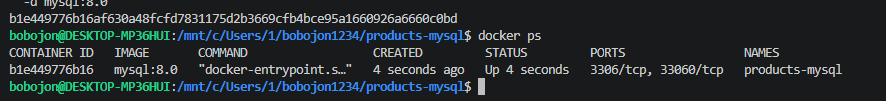
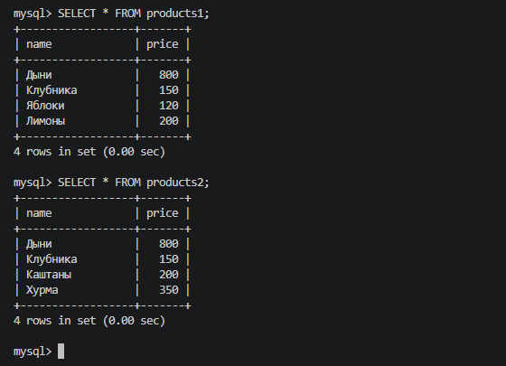
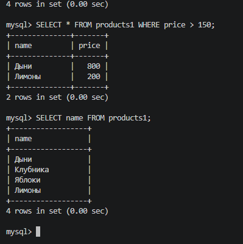
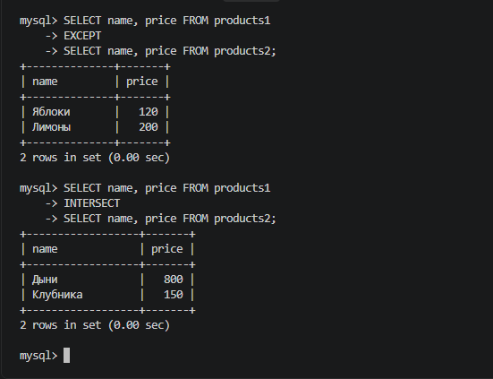
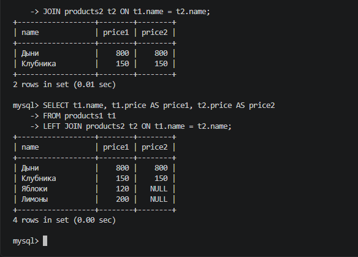
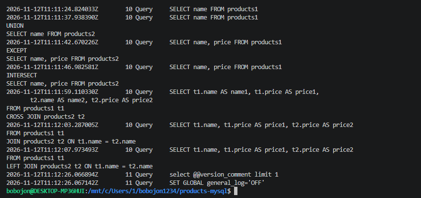
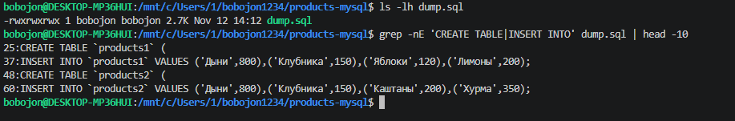
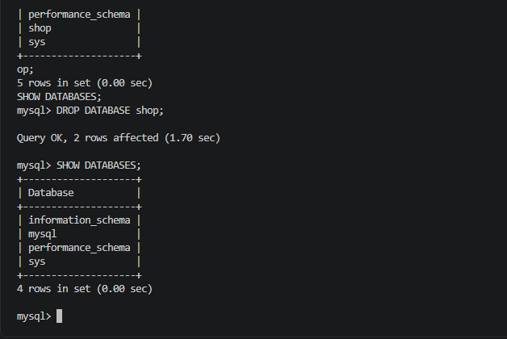
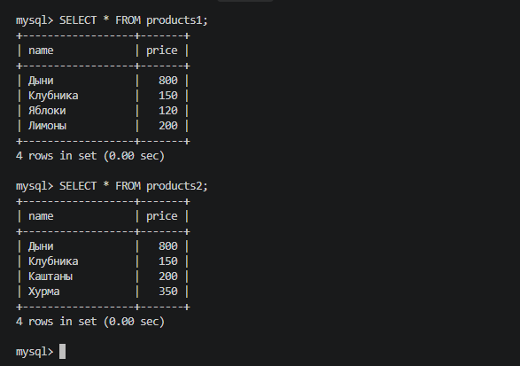

# Practical Work 4 — Основные SQL-операции в MySQL

Практическая работа по дисциплине **«Основы проектирования баз данных»**: создание двух таблиц товаров в MySQL 8.0, выполнение операций над данными и множествами, резервное копирование и восстановление базы данных в Docker.

## Задание

**Методичка:** [Основные SQL-операции на примере двух таблиц «products 1» и «products 2»](https://github.com/rurewa/imfua/blob/main/content/Courses/Basics_database_design/content/bd/Products.md)

**Цель:** отработать операции `SELECT`, проекцию, `UNION`, `EXCEPT`, `INTERSECT`, `CROSS JOIN`, `JOIN` и `LEFT JOIN`; создать SQL-дамп, удалить и восстановить базу данных.

**Инструменты:** Windows, WSL (Ubuntu), Docker Desktop, MySQL 8.0, VS Code, Git.

## Что сделано

1. Подготовлена отдельная папка проекта `products-mysql`, конфигурация `my.cnf` с кодировкой `utf8mb4` и файловым логированием.
2. Запущен контейнер `products-mysql`; создана база `shop` и таблицы `products1`, `products2`.
3. В каждую таблицу добавлено по четыре товара.
4. Выполнены основные операции SQL: фильтрация, выбор столбцов, объединение, разность, пересечение и соединение таблиц.
5. Сохранены журналы SQL-запросов `general.log` и `my_actions.log`.
6. Создан резервный дамп `dump.sql`, проведено удаление БД `shop` и её восстановление из дампа.

## Структура проекта

```text
products-mysql/
├── README.md
├── my.cnf
├── dump.sql
├── general.log
├── my_actions.log
└── screenshots/
    ├── 01-container.png
    ├── 02-data.png
    ├── 03-select.png
    ├── 04-sets.png
    ├── 05-joins.png
    ├── 06-log.png
    ├── 07-dump.png
    ├── 08-drop.png
    └── 09-restore.png
```

## Ход выполнения

### 1. Подготовка окружения и запуск MySQL

Создана конфигурация `my.cnf` с поддержкой кириллицы и включённым общим журналом запросов:

```ini
[mysqld]
character-set-server = utf8mb4
collation-server = utf8mb4_unicode_ci
general_log = 1
general_log_file = /var/lib/mysql/general.log
log_output = FILE

[client]
default-character-set = utf8mb4

[mysql]
default-character-set = utf8mb4
```

Контейнер запускается на официальном образе `mysql:8.0`, с отдельным Docker-томом `products_mysql_data` и подключённой конфигурацией:

```bash
docker run --name products-mysql \
  -e MYSQL_ROOT_PASSWORD=123 \
  -e LANG=C.UTF-8 \
  -e MYSQL_INITDB_SKIP_TZINFO=1 \
  -v products_mysql_data:/var/lib/mysql \
  -v "$HOME/mysql-products-config/my.cnf:/etc/mysql/conf.d/my.cnf:ro" \
  -d mysql:8.0

docker ps
```

> Пароль `123` приведён только для учебного окружения. В реальных системах нужен надёжный пароль.



### 2. Создание базы данных и заполнение таблиц

В MySQL создана база `shop` с кодировкой `utf8mb4`, две таблицы с полями `name` и `price` и тестовые записи:

```sql
CREATE DATABASE shop
  CHARACTER SET utf8mb4
  COLLATE utf8mb4_unicode_ci;
USE shop;

CREATE TABLE products1 (
    name VARCHAR(100) NOT NULL,
    price INT NOT NULL
);

CREATE TABLE products2 (
    name VARCHAR(100) NOT NULL,
    price INT NOT NULL
);

INSERT INTO products1 (name, price) VALUES
('Дыни', 800),
('Клубника', 150),
('Яблоки', 120),
('Лимоны', 200);

INSERT INTO products2 (name, price) VALUES
('Дыни', 800),
('Клубника', 150),
('Каштаны', 200),
('Хурма', 350);

SHOW TABLES;
SELECT * FROM products1;
SELECT * FROM products2;
```

В каждой таблице — по четыре товара. Совпадающие позиции: **дыни** и **клубника**.



### 3. Выборка и проекция

Выборка товаров первой таблицы дороже 150:

```sql
SELECT * FROM products1 WHERE price > 150;
```

Проекция — вывод только столбца `name`:

```sql
SELECT name FROM products1;
```

Выборка по цене возвращает **дыни** и **лимоны**.



### 4. Операции над множествами: UNION, EXCEPT, INTERSECT

`UNION` собирает уникальные названия из обеих таблиц:

```sql
SELECT name FROM products1
UNION
SELECT name FROM products2;
```

`EXCEPT` находит записи, которые есть только в первой таблице:

```sql
SELECT name, price FROM products1
EXCEPT
SELECT name, price FROM products2;
```

`INTERSECT` находит записи, которые присутствуют в обеих таблицах:

```sql
SELECT name, price FROM products1
INTERSECT
SELECT name, price FROM products2;
```

| Операция | Результат на исходных данных |
|---|---|
| `UNION` | 6 уникальных названий |
| `EXCEPT` | Яблоки, лимоны |
| `INTERSECT` | Дыни, клубника |

> `EXCEPT` и `INTERSECT` доступны начиная с MySQL 8.0.31.



### 5. CROSS JOIN, JOIN и LEFT JOIN

`CROSS JOIN` создаёт все возможные сочетания строк: четыре товара × четыре товара = **16 пар**.

```sql
SELECT t1.name AS name1, t1.price AS price1,
       t2.name AS name2, t2.price AS price2
FROM products1 t1
CROSS JOIN products2 t2;
```

`JOIN` показывает товары с одинаковыми названиями в обеих таблицах:

```sql
SELECT t1.name, t1.price AS price1, t2.price AS price2
FROM products1 t1
JOIN products2 t2 ON t1.name = t2.name;
```

`LEFT JOIN` сохраняет все товары первой таблицы, включая не имеющие пары во второй:

```sql
SELECT t1.name, t1.price AS price1, t2.price AS price2
FROM products1 t1
LEFT JOIN products2 t2 ON t1.name = t2.name;
```

В последнем запросе для яблок и лимонов цена второй таблицы будет `NULL`.



### 6. Сохранение SQL-лога

Для фиксации учебных действий использовано общее логирование MySQL. Сохранены два файла:

- `general.log` — журнал запросов, скопированный из контейнера;
- `my_actions.log` — сокращённая выборка учебных команд из журнала.

```bash
docker cp products-mysql:/var/lib/mysql/general.log ./general.log
```

Проверка содержимого:

```bash
ls -lh general.log my_actions.log
cat my_actions.log
```



### 7. Создание резервной копии

Утилита `mysqldump` сохраняет структуру и данные базы `shop` в SQL-файл:

```bash
docker exec -e MYSQL_PWD=123 products-mysql mysqldump -uroot \
  --set-gtid-purged=OFF \
  --single-transaction \
  shop > dump.sql
```

Проверка наличия команд создания и заполнения таблиц:

```bash
ls -lh dump.sql
grep -nE 'CREATE TABLE|INSERT INTO' dump.sql | head -10
```



### 8. Удаление базы данных

После проверки дампа выполнено удаление базы `shop`:

```sql
SHOW DATABASES;
DROP DATABASE shop;
SHOW DATABASES;
```

После удаления `shop` отсутствует в списке баз.



### 9. Восстановление базы из дампа

Сначала заново создана пустая база:

```sql
CREATE DATABASE shop
  CHARACTER SET utf8mb4
  COLLATE utf8mb4_unicode_ci;
```

Затем в терминале WSL импортирован `dump.sql`:

```bash
docker exec -i -e MYSQL_PWD=123 products-mysql mysql -uroot shop < dump.sql
```

Проверка после восстановления:

```sql
USE shop;
SHOW TABLES;
SELECT * FROM products1;
SELECT * FROM products2;
```

Восстановлены обе таблицы с исходными записями.



## Результат и вывод

В работе изучены выборка строк, проекция столбцов, объединение, разность и пересечение множеств, декартово произведение, внутреннее и левое соединения таблиц. На примере базы `shop` отработаны создание и заполнение таблиц, экспорт SQL-дампа, удаление и восстановление данных.

В папке проекта размещены **дамп базы, SQL-логи и девять скриншотов** соответствующих этапов. Полученные навыки показывают, как MySQL выполняет базовые операции реляционной алгебры и как сохранить базу для последующего восстановления.
