# Практическая работа № 2 — Интерактивная работа с MySQL в Docker

**Тема:** работа с MySQL 8.0 в изолированном Docker-контейнере: запросы SQL, связи между таблицами, представления, журналирование, резервное копирование и восстановление базы данных.

**Задание:** [«Интерактивная работа с MySQL в изолированном окружении Docker № 2»](https://github.com/rurewa/imfua/blob/main/content/Courses/Basics_database_design/content/bd/Begin_MySQL_2.md)

## Цель работы

Закрепить навыки работы с MySQL в Docker: создание связанных таблиц на движке InnoDB, заполнение и изменение данных, выполнение запросов с фильтрацией, агрегацией, соединениями и подзапросами; настройка общего журнала SQL-запросов, создание дампа и проверка восстановления базы данных.

## Что выполнено

- Использован контейнер `my-mysql` с MySQL 8.0, подготовленный для первой практической работы.
- Настроена кодировка `utf8mb4` и запись общего журнала запросов в таблицу `mysql.general_log`.
- Создано представление `my_actions` для просмотра запросов из общего журнала.
- Созданы связанные таблицы `customers` и `orders` с первичными и внешним ключами.
- Добавлены учебные записи клиентов и заказов.
- Выполнены запросы `SELECT`, `WHERE`, `ORDER BY`, `LIMIT`, `LIKE`, `BETWEEN`, `IN`, агрегатные функции, `GROUP BY`, `HAVING`, разные виды `JOIN`, подзапросы, `EXISTS`, `UNION` и `UNION ALL`.
- Проверены операции `UPDATE`, `DELETE`, `ALTER TABLE`.
- Экспортирован отфильтрованный журнал запросов в `my_actions_export.txt`.
- Создан резервный дамп `dump_clean.sql`; база удалена и восстановлена из дампа.
- Подготовлены **18 скриншотов** этапов выполнения практической работы.

## Структура проекта

```text
mysql-docker-practice-2/
├── README.md                  # Отчёт о выполненной практике
├── dump_clean.sql             # Резервная копия sql_practice
├── my_actions_export.txt      # Экспорт отфильтрованного журнала запросов
└── screenshots/
    ├── 01-container.png
    ├── 02-logging.png
    ├── 03-view.png
    ├── 04-tables.png
    ├── 05-database-files.png
    ├── 06-insert.png
    ├── 07-select.png
    ├── 08-aggregates.png
    ├── 09-groupby.png
    ├── 10-joins.png
    ├── 11-subqueries.png
    ├── 12-union.png
    ├── 13-update-delete.png
    ├── 14-alter.png
    ├── 15-logs.png
    ├── 16-dump.png
    ├── 17-drop.png
    └── 18-restore.png
```

> **Примечание.** Файл конфигурации `my.cnf` использован из первой практической работы (`mysql-docker-practice/my.cnf`). В этом задании для журнала выбрано `log_output = TABLE`. Скриншоты находятся в папке `screenshots` рядом с этим README и отображаются ниже в каждом разделе.

## Ход выполнения работы

### 1. Проверка и запуск Docker-контейнера

Проверен контейнер MySQL. После изменения конфигурации контейнер перезапущен.

```bash
docker ps -a
docker restart my-mysql
docker ps
```

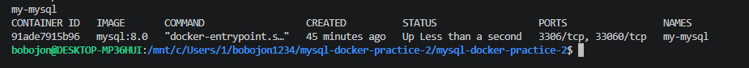

### 2. Настройка логирования MySQL

Общий журнал включён с сохранением запросов в таблицу `mysql.general_log`.

```ini
[mysqld]
character-set-server = utf8mb4
collation-server = utf8mb4_unicode_ci
general_log = 1
log_output = TABLE

[client]
default-character-set = utf8mb4

[mysql]
default-character-set = utf8mb4
```

Для подключения использована команда:

```bash
docker exec -it my-mysql mysql --default-character-set=utf8mb4 -uroot -p
```

Настройки проверены запросами:

```sql
SET GLOBAL general_log = 'ON';
SET GLOBAL log_output = 'TABLE';
SHOW VARIABLES LIKE 'general_log%';
SHOW VARIABLES LIKE 'log_output';
```

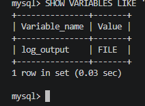

### 3. Создание базы и представления VIEW

В качестве учебной базы использована `sql_practice`. Для просмотра действий пользователя создано представление `my_actions`, которое читает записи общего журнала.

```sql
CREATE DATABASE IF NOT EXISTS sql_practice
  CHARACTER SET utf8mb4 COLLATE utf8mb4_unicode_ci;
USE sql_practice;

CREATE OR REPLACE VIEW my_actions AS
SELECT event_time,
       command_type,
       CONVERT(argument USING utf8mb4) AS argument
FROM mysql.general_log
WHERE user_host LIKE '%root%'
  AND command_type = 'Query'
  AND argument NOT LIKE 'SET %'
  AND argument NOT LIKE 'SHOW %'
  AND argument NOT LIKE 'SELECT @@%'
  AND argument NOT LIKE 'SELECT DATABASE()%'
  AND argument NOT LIKE 'SELECT * FROM my_actions%'
  AND argument NOT LIKE 'TRUNCATE TABLE mysql.general_log%'
  AND argument NOT LIKE 'CREATE OR REPLACE VIEW my_actions%';

SHOW FULL TABLES WHERE Table_type = 'VIEW';
SELECT * FROM my_actions ORDER BY event_time DESC LIMIT 20;
```

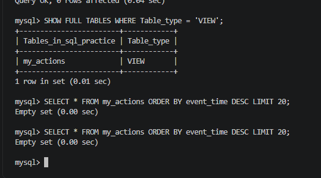

### 4. Создание связанных таблиц

Созданы таблицы `customers` (клиенты) и `orders` (заказы). Поле `orders.customer_id` ссылается на первичный ключ `customers.id`.

```sql
CREATE TABLE customers (
    id INT AUTO_INCREMENT PRIMARY KEY,
    name VARCHAR(100) NOT NULL,
    email VARCHAR(100) NOT NULL UNIQUE,
    city VARCHAR(100),
    created_at TIMESTAMP DEFAULT CURRENT_TIMESTAMP
) ENGINE=InnoDB CHARACTER SET utf8mb4 COLLATE utf8mb4_unicode_ci;

CREATE TABLE orders (
    id INT AUTO_INCREMENT PRIMARY KEY,
    customer_id INT NOT NULL,
    order_date DATE NOT NULL,
    amount DECIMAL(10, 2) NOT NULL,
    status VARCHAR(20) DEFAULT 'new',
    FOREIGN KEY (customer_id) REFERENCES customers(id)
) ENGINE=InnoDB CHARACTER SET utf8mb4 COLLATE utf8mb4_unicode_ci;

SHOW TABLES;
DESCRIBE customers;
DESCRIBE orders;
```

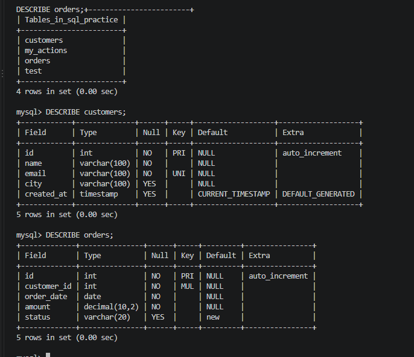

### 5. Проверка файлов InnoDB

После выхода из клиента MySQL проверены файлы таблиц в каталоге базы внутри контейнера.

```bash
docker exec -it my-mysql ls -la /var/lib/mysql/sql_practice
```

В каталоге присутствуют файлы `customers.ibd` и `orders.ibd`.

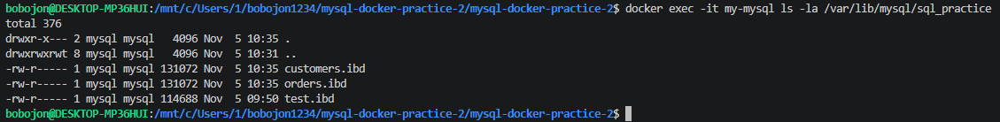

### 6. Добавление данных — INSERT

Внесены пять клиентов и шесть заказов; данные проверены запросами `SELECT`.

```sql
USE sql_practice;

INSERT INTO customers (name, email, city) VALUES
  ('Иван Иванов', 'ivan@example.com', 'Москва'),
  ('Пётр Петров', 'petr@example.com', 'Санкт-Петербург'),
  ('Мария Сидорова', 'maria@example.com', 'Москва'),
  ('Алексей Смирнов', 'alex@example.com', 'Казань'),
  ('Ольга Кузнецова', 'olga@example.com', 'Новосибирск');

INSERT INTO orders (customer_id, order_date, amount, status) VALUES
  (1, '2026-10-01', 1500.00, 'paid'),
  (1, '2026-10-05', 2300.50, 'paid'),
  (2, '2026-10-03', 800.00, 'new'),
  (3, '2026-10-07', 4200.00, 'paid'),
  (3, '2026-10-10', 1100.00, 'cancelled'),
  (4, '2026-10-12', 950.00, 'new');

SELECT * FROM customers;
SELECT * FROM orders;
```

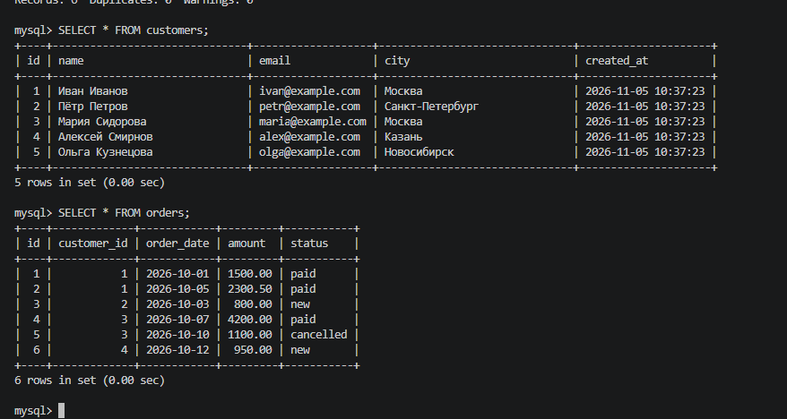

### 7. Выборка и фильтрация — SELECT

Проверены выборка столбцов, условия `WHERE`, сортировка, ограничение количества строк и поиск по шаблону.

```sql
SELECT name, city FROM customers;
SELECT * FROM customers WHERE city = 'Москва';
SELECT * FROM orders WHERE amount > 1000;
SELECT * FROM orders WHERE status = 'paid' AND amount > 1500;
SELECT * FROM orders ORDER BY amount DESC LIMIT 3;
SELECT * FROM customers WHERE name LIKE 'И%';
SELECT * FROM orders WHERE amount BETWEEN 1000 AND 3000;
SELECT * FROM customers WHERE city IN ('Москва', 'Казань');
SELECT * FROM customers WHERE city IS NULL;
```

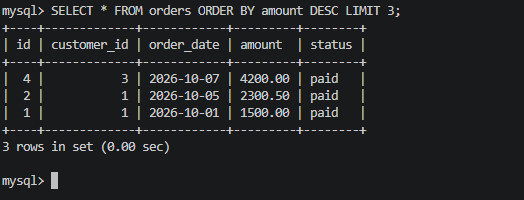

### 8. Агрегатные функции

С помощью `COUNT`, `SUM`, `AVG`, `MIN` и `MAX` получена статистика по суммам заказов.

```sql
SELECT COUNT(*) AS total_orders FROM orders;
SELECT SUM(amount) AS total_sum FROM orders;
SELECT AVG(amount) AS avg_amount FROM orders;
SELECT MIN(amount) AS min_amount, MAX(amount) AS max_amount FROM orders;
```

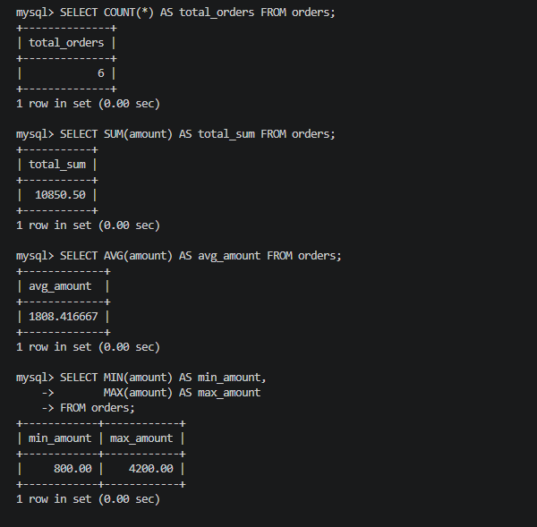

### 9. Группировка — GROUP BY и HAVING

Посчитано количество заказов и их стоимость по каждому клиенту; группы отфильтрованы по общей сумме.

```sql
SELECT customer_id, COUNT(*) AS order_count, SUM(amount) AS total_amount
FROM orders
GROUP BY customer_id;

SELECT c.name, COUNT(o.id) AS order_count, SUM(o.amount) AS total_amount
FROM customers c
JOIN orders o ON c.id = o.customer_id
GROUP BY c.id, c.name
ORDER BY total_amount DESC;

SELECT customer_id, SUM(amount) AS total_amount
FROM orders
GROUP BY customer_id
HAVING SUM(amount) > 2000;
```

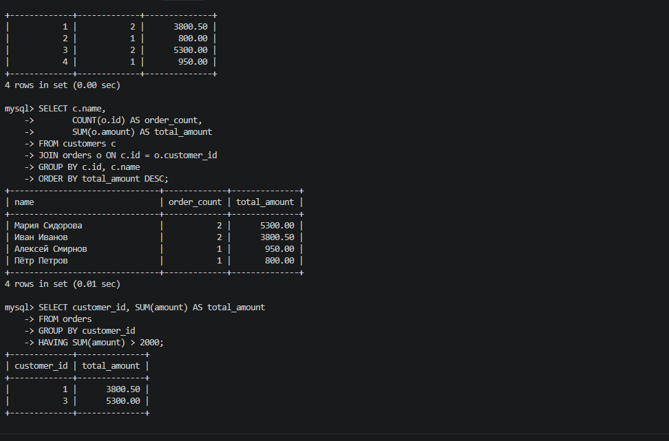

### 10. Соединение таблиц — JOIN

Проверены `INNER JOIN`, `LEFT JOIN` и `RIGHT JOIN`, а также соединение с агрегированием. Для клиентов без заказов применена функция `COALESCE`.

```sql
SELECT c.name, o.order_date, o.amount, o.status
FROM customers c
INNER JOIN orders o ON c.id = o.customer_id;

SELECT c.name, o.id AS order_id, o.amount
FROM customers c
LEFT JOIN orders o ON c.id = o.customer_id;

SELECT c.name, o.id AS order_id
FROM customers c
RIGHT JOIN orders o ON c.id = o.customer_id;

SELECT c.name,
       COUNT(o.id) AS order_count,
       COALESCE(SUM(o.amount), 0) AS total_amount
FROM customers c
LEFT JOIN orders o ON c.id = o.customer_id
GROUP BY c.id, c.name
ORDER BY total_amount DESC;
```

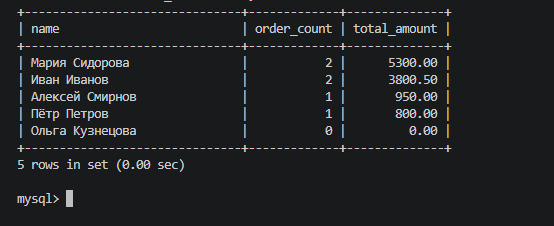

### 11. Подзапросы и EXISTS

Использованы вложенные запросы в `WHERE`, `FROM` и `SELECT`, а также проверки существования записей с помощью `EXISTS` и `NOT EXISTS`.

```sql
SELECT name, city
FROM customers
WHERE id IN (
    SELECT customer_id FROM orders WHERE amount > 1000
);

SELECT c.name,
       (SELECT COUNT(*) FROM orders o WHERE o.customer_id = c.id) AS order_count
FROM customers c;

SELECT name FROM customers c
WHERE EXISTS (
    SELECT 1 FROM orders o WHERE o.customer_id = c.id
);

SELECT name FROM customers c
WHERE NOT EXISTS (
    SELECT 1 FROM orders o WHERE o.customer_id = c.id
);
```

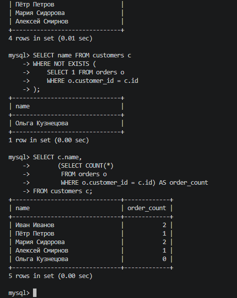

### 12. UNION и UNION ALL

Проверено объединение результатов нескольких запросов: `UNION` устраняет одинаковые строки, `UNION ALL` сохраняет их.

```sql
SELECT name, city FROM customers WHERE city = 'Москва'
UNION
SELECT name, city FROM customers WHERE city = 'Казань';

SELECT city FROM customers
UNION ALL
SELECT city FROM customers;
```

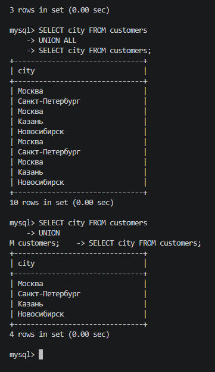

### 13. Изменение и удаление записей

С помощью `UPDATE` изменены город клиента и статус заказа. Затем команда `DELETE` удалила шестой заказ.

```sql
UPDATE customers SET city = 'Екатеринбург' WHERE id = 4;
UPDATE orders SET status = 'paid' WHERE id = 3;
SELECT * FROM customers WHERE id = 4;
SELECT * FROM orders WHERE id = 3;

DELETE FROM orders WHERE id = 6;
SELECT * FROM orders;
```

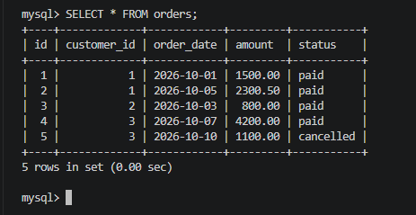

### 14. Изменение структуры — ALTER TABLE

В таблицу клиентов добавлен столбец `phone`, изменён его тип, затем столбец удалён.

```sql
ALTER TABLE customers ADD COLUMN phone VARCHAR(20);
UPDATE customers SET phone = '123-36-77' WHERE id = 4;
SELECT * FROM customers WHERE id = 4;

ALTER TABLE customers MODIFY COLUMN phone VARCHAR(30);
ALTER TABLE customers DROP COLUMN phone;
SELECT * FROM customers;
```

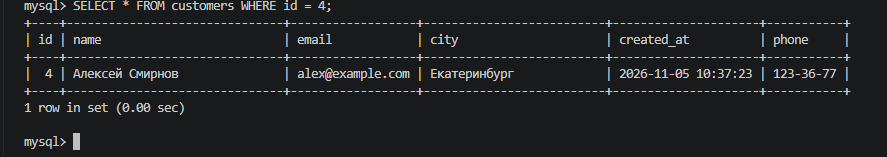

### 15. Просмотр и экспорт лога запросов

Запросы просмотрены через представление `my_actions`, после чего результат выгружен из контейнера в текстовый файл.

```sql
SELECT * FROM my_actions ORDER BY event_time DESC LIMIT 20;
SELECT * FROM my_actions
WHERE argument LIKE '%customers%'
ORDER BY event_time DESC LIMIT 10;
```

Команда экспорта в терминале WSL:

```bash
docker exec -e MYSQL_PWD=123 my-mysql mysql -uroot \
  --default-character-set=utf8mb4 \
  -e "SELECT * FROM sql_practice.my_actions ORDER BY event_time DESC" \
  > my_actions_export.txt
```

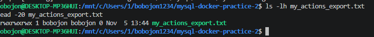

### 16. Создание резервной копии — mysqldump

Создан резервный SQL-дамп базы `sql_practice`. Параметр `--set-gtid-purged=OFF` исключает инструкции настройки GTID, а `--single-transaction` используется для согласованного снимка таблиц InnoDB.

```bash
docker exec -e MYSQL_PWD=123 my-mysql mysqldump -uroot \
  --set-gtid-purged=OFF \
  --single-transaction \
  sql_practice > dump_clean.sql

ls -lh dump_clean.sql
head -30 dump_clean.sql
```

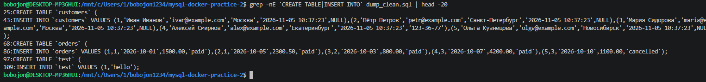

### 17. Удаление таблиц и базы данных

После создания резервной копии таблицы удалены в правильном порядке: сначала зависимая `orders`, затем `customers`. После этого удалена вся база `sql_practice`.

```sql
USE sql_practice;
DROP TABLE orders;
SHOW TABLES;
DROP TABLE customers;
SHOW TABLES;
DROP DATABASE sql_practice;
SHOW DATABASES;
```

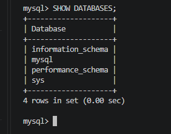

### 18. Восстановление базы из дампа

Сначала создана пустая база `sql_practice`:

```sql
CREATE DATABASE sql_practice
  CHARACTER SET utf8mb4 COLLATE utf8mb4_unicode_ci;
```

Затем в терминале WSL выполнен импорт:

```bash
docker exec -i my-mysql mysql -uroot -p123 sql_practice < dump_clean.sql
```

После восстановления проверены таблицы, представление `my_actions` и сохранённые записи:

```sql
USE sql_practice;
SHOW TABLES;
SHOW FULL TABLES WHERE Table_type = 'VIEW';
SELECT * FROM customers;
SELECT * FROM orders;
SELECT * FROM my_actions LIMIT 5;
```

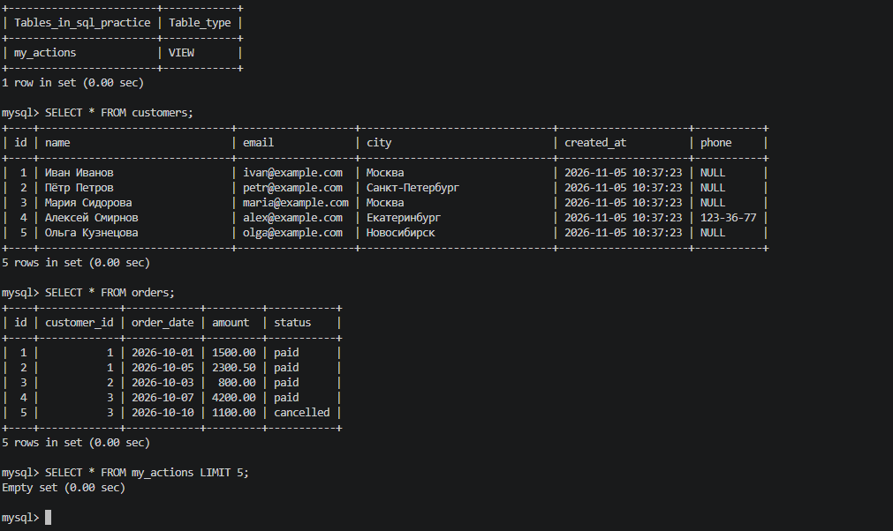

## Результат

В ходе второй практической работы изучены основные возможности SQL в MySQL 8.0 и взаимодействие с реляционной базой данных в Docker. Созданы связанные таблицы клиентов и заказов; выполнены запросы различной сложности; настроено журналирование действий. Отработан полный цикл резервного копирования: **экспорт → удаление базы → восстановление из SQL-дампа → проверка данных**.

## Вывод

Использование Docker позволяет работать с MySQL в изолированном окружении, а движок InnoDB обеспечивает поддержку внешних ключей и транзакций. Получены практические навыки обработки данных, построения SQL-запросов, анализа журналов и восстановления базы из резервной копии.
