# Практическая работа № 3 — Представления (VIEW) в MySQL

## Задание

**Тема:** Работа с представлениями (VIEW) в MySQL в изолированном Docker-окружении.

**Источник:** [Руководство по представлениям (VIEW) в MySQL — rurewa/imfua](https://github.com/rurewa/imfua/blob/main/content/Courses/Basics_database_design/content/bd/VIEW_MySQL.md)

**Цель работы:** научиться создавать, использовать, изменять и удалять представления MySQL; работать с обновляемыми и необновляемыми VIEW, `WITH CHECK OPTION`, правами доступа и планами запросов; сохранять SQL-дамп и журналы действий.

## Что сделано

- Подготовлена отдельная папка `mysql-view-practice` для третьей практической работы.
- Настроен MySQL 8.0 с кодировкой `utf8mb4` и файловым журналированием SQL-запросов.
- Для сохранения результатов предыдущих работ использованы отдельный контейнер `my-mysql-view` и том `mysql_view_data`.
- Создана база `sql_practice` с таблицами `customers` и `orders`, связанными внешним ключом.
- Созданы простое представление `moscow_customers` и сводное `customer_summary` с `LEFT JOIN`, `GROUP BY` и агрегатными функциями.
- Выполнены фильтрация данных через VIEW, просмотр определений, изменение и удаление представлений.
- Проверены обновляемые и необновляемые VIEW, включая ожидаемую ошибку изменения агрегатного представления.
- Выполнен анализ запроса через `EXPLAIN` и проверена работа `WITH CHECK OPTION`.
- Создано представление `public_customers`, настроен доступ к нему для отдельного пользователя `analyst`.
- Подготовлен SQL-дамп `dump.sql` и журналы `general.log` и `my_actions.log`.
- Подготовлены 18 скриншотов основных этапов работы.

## Использованные инструменты

- Windows, WSL (Ubuntu), VS Code
- Docker Desktop и Docker CLI
- MySQL 8.0, движок таблиц InnoDB
- Git и GitHub

## Структура проекта

```text
mysql-view-practice/
├── README.md
├── my.cnf
├── dump.sql
├── general.log
├── my_actions.log
└── screenshots/
    ├── 01-config.png
    ├── 02-container.png
    ├── 03-tables.png
    ├── 04-moscow-view.png
    ├── 05-summary-view.png
    ├── 06-view-filter.png
    ├── 07-list-views.png
    ├── 08-replace-view.png
    ├── 09-drop-view.png
    ├── 10-updatable-view.png
    ├── 11-not-updatable.png
    ├── 12-explain.png
    ├── 13-check-option.png
    ├── 14-permissions.png
    ├── 15-dump.png
    ├── 16-general-log.png
    ├── 17-filtered-log.png
    └── 18-final-check.png
```

> Изображения в этом README подключаются по относительным путям `screenshots/имя-файла.png`. Для отображения на GitHub папка `screenshots` должна находиться рядом с `README.md`. Исходные логи необходимо проверить на наличие паролей и конфиденциальных данных до публикации.

## Ход выполнения работы

### 1. Настройка MySQL (`my.cnf`)

Создан файл конфигурации MySQL с поддержкой кириллицы и записью общего журнала SQL-запросов в файл:

```ini
[mysqld]
character-set-server = utf8mb4
collation-server = utf8mb4_unicode_ci
general_log = 1
general_log_file = /var/lib/mysql/general.log
log_output = FILE

[client]
default-character-set = utf8mb4

[mysql]
default-character-set = utf8mb4
```

Для корректной работы прав доступа контейнер использует копию конфигурации в файловой системе WSL (`~/mysql-view-config/my.cnf`), а экземпляр конфигурации сохранён в проекте.

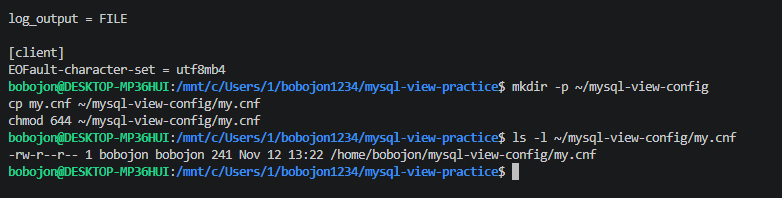

### 2. Запуск отдельного Docker-контейнера

Для этой работы создан самостоятельный контейнер, который не затрагивает базы первых двух практических:

```bash
# Схема команды запуска; секретный пароль не указан в отчёте.
docker run --name my-mysql-view \
  -e MYSQL_ROOT_PASSWORD='<учебный_пароль>' \
  -e LANG=C.UTF-8 \
  -e MYSQL_INITDB_SKIP_TZINFO=1 \
  -v mysql_view_data:/var/lib/mysql \
  -v "$HOME/mysql-view-config/my.cnf:/etc/mysql/conf.d/my.cnf:ro" \
  -d mysql:8.0

docker ps
```

**Результат:** запущен контейнер `my-mysql-view` с отдельным томом `mysql_view_data`.

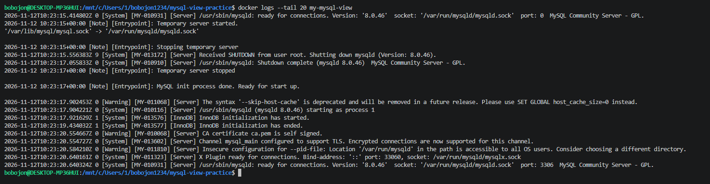

### 3. Создание базы данных и исходных таблиц

Подключение к MySQL:

```bash
docker exec -it my-mysql-view mysql --default-character-set=utf8mb4 -uroot -p
```

Создание базы и двух связанных таблиц:

```sql
CREATE DATABASE sql_practice
  CHARACTER SET utf8mb4
  COLLATE utf8mb4_unicode_ci;

USE sql_practice;

CREATE TABLE customers (
    id INT AUTO_INCREMENT PRIMARY KEY,
    name VARCHAR(100) NOT NULL,
    email VARCHAR(100) NOT NULL UNIQUE,
    city VARCHAR(100),
    created_at TIMESTAMP DEFAULT CURRENT_TIMESTAMP
) CHARACTER SET utf8mb4 COLLATE utf8mb4_unicode_ci;

CREATE TABLE orders (
    id INT AUTO_INCREMENT PRIMARY KEY,
    customer_id INT NOT NULL,
    order_date DATE NOT NULL,
    amount DECIMAL(10, 2) NOT NULL,
    status VARCHAR(20) DEFAULT 'new',
    FOREIGN KEY (customer_id) REFERENCES customers(id)
) CHARACTER SET utf8mb4 COLLATE utf8mb4_unicode_ci;
```

Добавлены пять клиентов и шесть заказов:

```sql
INSERT INTO customers (name, email, city) VALUES
('Иван Иванов', 'ivan@example.com', 'Москва'),
('Пётр Петров', 'petr@example.com', 'Санкт-Петербург'),
('Мария Сидорова', 'maria@example.com', 'Москва'),
('Алексей Смирнов', 'alex@example.com', 'Казань'),
('Ольга Кузнецова', 'olga@example.com', 'Новосибирск');

INSERT INTO orders (customer_id, order_date, amount, status) VALUES
(1, '2026-10-01', 1500.00, 'paid'),
(1, '2026-10-05', 2300.50, 'paid'),
(2, '2026-10-03', 800.00, 'new'),
(3, '2026-10-07', 4200.00, 'paid'),
(3, '2026-10-10', 1100.00, 'cancelled'),
(4, '2026-10-12', 950.00, 'new');

SHOW TABLES;
SELECT * FROM customers;
SELECT * FROM orders;
```

**Результат:** исходные таблицы подготовлены для демонстрации представлений.

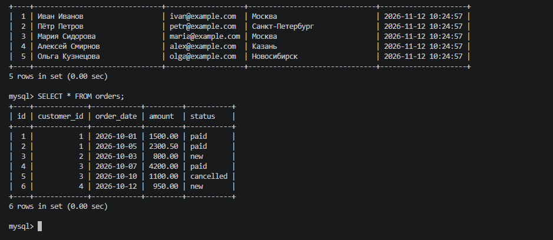

### 4. Простое представление `moscow_customers`

Создано VIEW для получения клиентов из Москвы без повторного написания условия фильтрации:

```sql
CREATE VIEW moscow_customers AS
SELECT id, name, email
FROM customers
WHERE city = 'Москва';

SELECT * FROM moscow_customers;
```

**Результат на исходных данных:** Иван Иванов и Мария Сидорова.

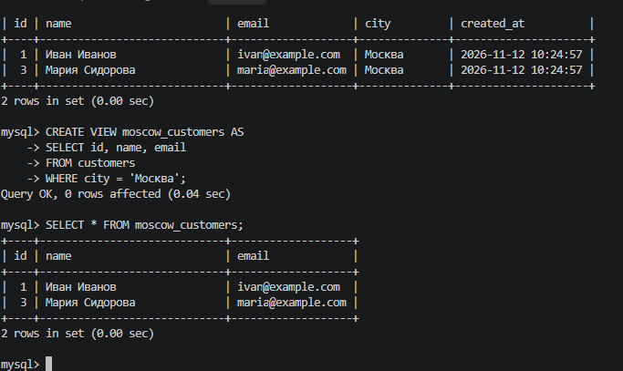

### 5. Сводное представление с `JOIN` и агрегацией

Создано `customer_summary`, объединяющее клиентов с заказами и вычисляющее число и общую сумму заказов:

```sql
CREATE VIEW customer_summary AS
SELECT c.id,
       c.name,
       c.city,
       COUNT(o.id) AS order_count,
       COALESCE(SUM(o.amount), 0) AS total_amount
FROM customers c
LEFT JOIN orders o ON c.id = o.customer_id
GROUP BY c.id, c.name, c.city;

SELECT * FROM customer_summary ORDER BY total_amount DESC;
```

**Результат на исходных данных:** у Марии Сидоровой — 2 заказа на 5300.00; у Ивана Иванова — 2 заказа на 3800.50. Клиент без заказов отображается с нулевой суммой.

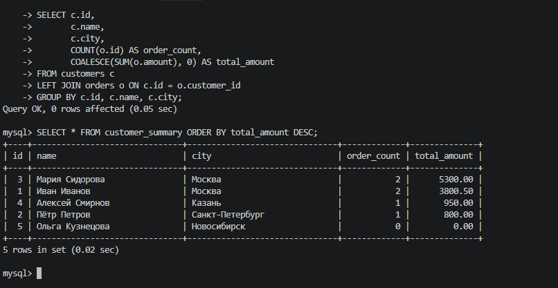

### 6. Дополнительная фильтрация представления

При обращении к представлению можно использовать внешнее условие `WHERE`:

```sql
SELECT * FROM customer_summary WHERE city = 'Москва';

SELECT name, total_amount
FROM customer_summary
WHERE total_amount > 2000;
```

**Результат:** отобраны клиенты по городу и общей сумме покупок.

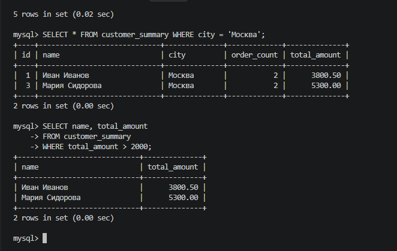

### 7. Просмотр списка и определений VIEW

Для получения списка представлений и текста хранящегося SQL-запроса использованы:

```sql
SHOW FULL TABLES WHERE Table_type = 'VIEW';
SHOW TABLES;
SHOW CREATE VIEW customer_summary\G
```

**Результат:** проверены имена и определение созданных VIEW.

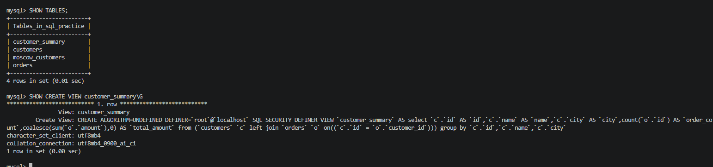

### 8. Изменение существующего VIEW

Команда `CREATE OR REPLACE VIEW` использована для добавления в результат `moscow_customers` поля `created_at`:

```sql
SELECT * FROM moscow_customers;

CREATE OR REPLACE VIEW moscow_customers AS
SELECT id, name, email, created_at
FROM customers
WHERE city = 'Москва';

SELECT * FROM moscow_customers;
```

**Результат:** в выборке появился дополнительный столбец `created_at`.

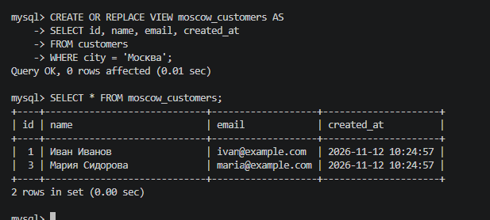

### 9. Удаление VIEW

```sql
DROP VIEW moscow_customers;
SHOW FULL TABLES WHERE Table_type = 'VIEW';
```

**Результат:** представление удалено, исходная таблица `customers` осталась без изменений.

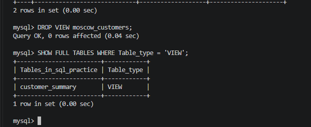

### 10. Обновляемое представление

Создано `active_customers`, которое позволяет изменять строки базовой таблицы:

```sql
CREATE VIEW active_customers AS
SELECT id, name, email, city
FROM customers
WHERE city IS NOT NULL;

UPDATE active_customers SET city = 'Сочи' WHERE id = 2;
SELECT * FROM customers WHERE id = 2;

INSERT INTO active_customers (name, email, city)
VALUES ('Новый Клиент', 'new@example.com', 'Уфа');

SELECT * FROM customers;

DELETE FROM active_customers WHERE email = 'new@example.com';
SELECT * FROM customers;
```

**Результат:** изменение, добавление и удаление через VIEW отражаются в таблице `customers`.

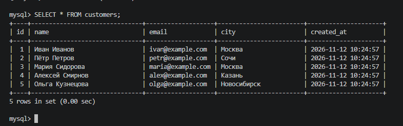

### 11. Необновляемое представление

`customer_summary` включает `GROUP BY` и агрегатные функции. Попытка изменить его через `UPDATE` использована как демонстрация ограничения:

```sql
UPDATE customer_summary SET name = 'X' WHERE id = 1;
```

**Ожидаемый результат:** ошибка `ERROR 1288 (HY000): ... is not updatable`. В данном случае ошибка подтверждает, что агрегатное VIEW нельзя обновлять таким способом.

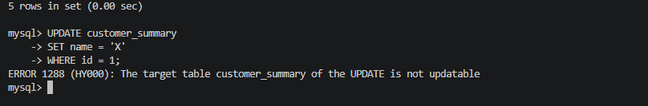

### 12. Анализ плана запроса

Для просмотра плана выполнения запроса через представление использована команда:

```sql
EXPLAIN SELECT * FROM customer_summary WHERE city = 'Москва';
SELECT * FROM customer_summary WHERE city = 'Москва';
```

**Результат:** получен план, по которому MySQL обрабатывает запрос.

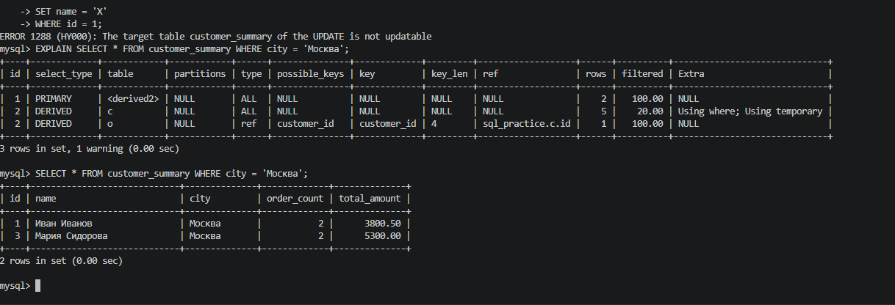

### 13. Проверка `WITH CHECK OPTION`

Сначала создано представление без проверки соответствия вставляемой строки условию `WHERE`:

```sql
CREATE OR REPLACE VIEW moscow_customers AS
SELECT id, name, email, city
FROM customers
WHERE city = 'Москва';

INSERT INTO moscow_customers (name, email, city)
VALUES ('Пётр Второй', 'petr2@example.com', 'Казань');

SELECT * FROM customers WHERE email = 'petr2@example.com';
SELECT * FROM moscow_customers;
```

**Наблюдение:** клиент из Казани появляется в таблице `customers`, но не отображается в `moscow_customers`.

Затем представление пересоздано с `WITH CHECK OPTION`:

```sql
CREATE OR REPLACE VIEW moscow_customers AS
SELECT id, name, email, city
FROM customers
WHERE city = 'Москва'
WITH CHECK OPTION;

INSERT INTO moscow_customers (name, email, city)
VALUES ('Пётр Третий', 'petr3@example.com', 'Казань');
```

**Ожидаемый результат:** `ERROR 1369 (HY000): CHECK OPTION failed`. Строка не соответствует условию представления и не добавляется.

После проверки удалены тестовые строки:

```sql
DELETE FROM customers
WHERE email IN ('petr2@example.com', 'petr3@example.com');
```

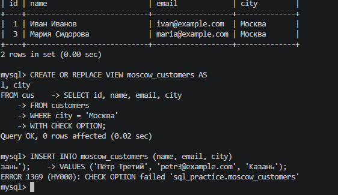

### 14. Ограничение доступа через VIEW

Создано представление без поля `email`, затем отдельному пользователю предоставлено право чтения только этого представления:

```sql
CREATE VIEW public_customers AS
SELECT id, name, city FROM customers;

-- Учебный пользователь создан с паролем; значение пароля в отчёте опущено.
CREATE USER 'analyst'@'%' IDENTIFIED BY '<учебный_пароль>';
GRANT SELECT ON sql_practice.public_customers TO 'analyst'@'%';
SHOW GRANTS FOR 'analyst'@'%';
```

При подключении под пользователем `analyst` выполнены проверки:

```sql
USE sql_practice;
SELECT * FROM public_customers;
SELECT * FROM customers;
```

**Результат:** чтение `public_customers` разрешено, прямой доступ к таблице `customers` запрещён.

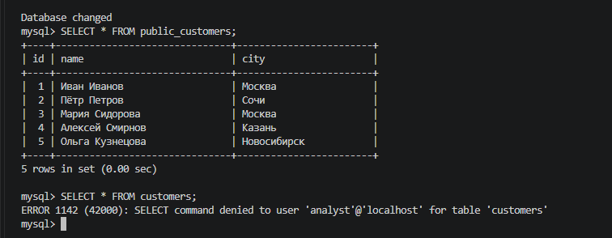

### 15. Создание SQL-дампа

После выхода из клиента MySQL создана резервная копия базы `sql_practice`:

```bash
docker exec -e MYSQL_PWD='<учебный_пароль>' my-mysql-view mysqldump -uroot \
  --set-gtid-purged=OFF \
  --single-transaction \
  sql_practice > dump.sql

ls -lh dump.sql
head -30 dump.sql
grep -n "VIEW" dump.sql | head -20
```

**Результат:** подготовлен `dump.sql`, включающий определения таблиц, данные и VIEW. Пароль здесь обозначен условно для безопасного размещения инструкции в публичном репозитории.

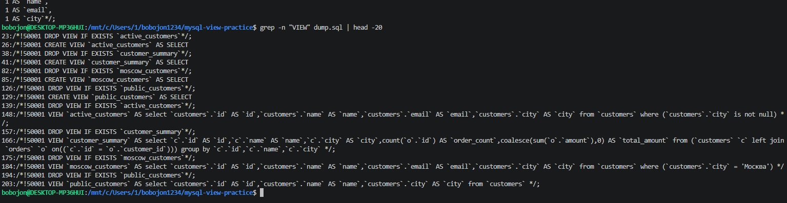

### 16. Проверка файлового SQL-лога

Проверены переменные MySQL:

```sql
SHOW VARIABLES LIKE 'general_log%';
SHOW VARIABLES LIKE 'log_output';
```

Для файлового журнала используются значения `general_log = ON`, `log_output = FILE` и путь `/var/lib/mysql/general.log`. Копирование журнала из контейнера:

```bash
docker exec my-mysql-view ls -lh /var/lib/mysql/general.log
docker cp my-mysql-view:/var/lib/mysql/general.log ./general.log
ls -lh general.log
```

**Результат:** журнал запросов сохранён рядом с файлами практической работы.

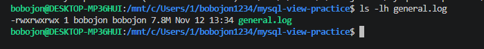

### 17. Отбор пользовательских действий из лога

Из общего журнала сформирован `my_actions.log` с SQL-запросами и уменьшенным объёмом служебных сообщений:

```bash
docker exec my-mysql-view cat /var/lib/mysql/general.log \
  | grep "Query" \
  | grep -v -E "SET NAMES|SET autocommit|SET sql_mode|SET character_set_results|SHOW VARIABLES|SHOW STATUS|SHOW WARNINGS|SELECT @@|SELECT DATABASE\\(\\)|time_zone" \
  | grep -vi -E "CREATE USER|IDENTIFIED BY|PASSWORD" \
  > my_actions.log

cat my_actions.log
wc -l my_actions.log
```

**Результат:** сформирован отдельный журнал основных SQL-действий. Фильтрация сама по себе не гарантирует удаления всех секретов — файл нужно проверить перед публикацией.

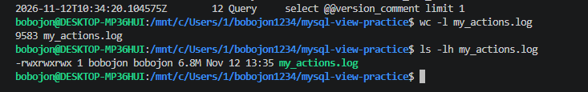

### 18. Финальная проверка

Проверены представления и данные в базе:

```sql
USE sql_practice;
SHOW FULL TABLES WHERE Table_type = 'VIEW';

SELECT * FROM customer_summary ORDER BY total_amount DESC;
SELECT * FROM moscow_customers;
SELECT * FROM public_customers;
SELECT * FROM customers;
SELECT * FROM orders;
```

В конце работы должны присутствовать четыре представления:

| Представление | Назначение |
| --- | --- |
| `active_customers` | Изменение строк через обновляемое VIEW |
| `customer_summary` | Сводка по заказам клиентов |
| `moscow_customers` | Клиенты из Москвы с `WITH CHECK OPTION` |
| `public_customers` | Ограниченное отображение данных без email |

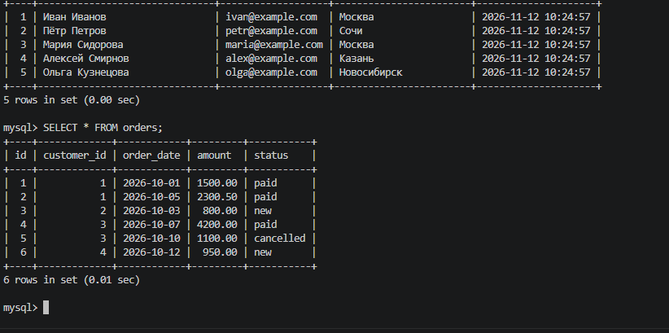

## Результаты работы

В практической работе изучены основные возможности MySQL VIEW: сохранённые запросы, использование VIEW как таблиц, соединение и агрегирование данных, изменение определений, обновляемость, проверка ограничений через `WITH CHECK OPTION`, разграничение доступа и анализ запроса через `EXPLAIN`.

В составе проекта предусмотрены `dump.sql`, SQL-логи и 18 скриншотов, фиксирующих этапы выполнения. Сами скриншоты хранятся в каталоге `screenshots/` и отображаются в README по относительным ссылкам.

## Вывод

Представления MySQL позволяют повторно использовать запросы, упрощать обращение к данным и предоставлять пользователям доступ к выбранным столбцам без прямого доступа к исходным таблицам. Возможность изменения данных через VIEW зависит от его определения, а `WITH CHECK OPTION` контролирует соответствие вставляемых и изменяемых строк заданному фильтру. Созданный дамп и журналы обеспечивают документирование и резервное копирование результатов практической работы.

---

**Примечание по безопасности:** для публичного репозитория не следует публиковать пароли и необработанные журналы, содержащие учётные данные. В приведённых в README командах пароли заменены на условное обозначение; перед отправкой обязательно проверьте содержимое `general.log`, `my_actions.log` и `dump.sql`.
